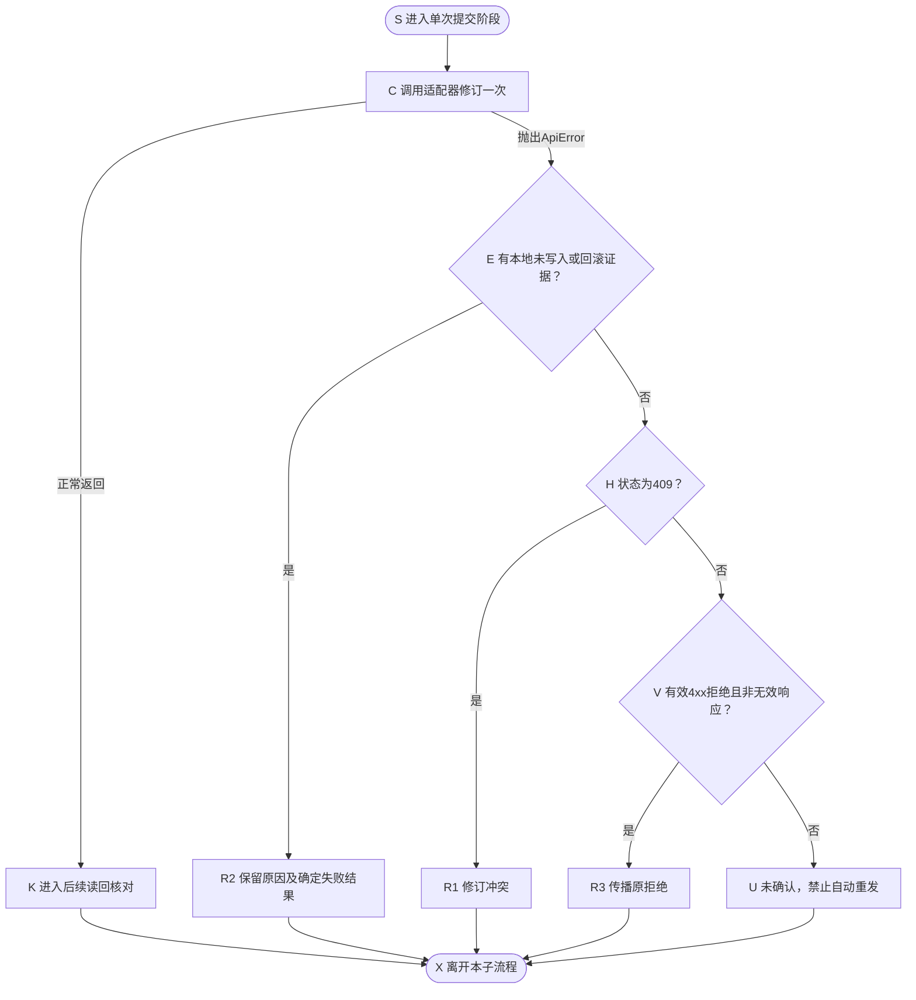

# 修订保存错误语义修复与白盒测试分析

编写人：李洪（2024141460331）　日期：2026-11-10　版本：V1.0

## 1 范围与需求依据

本次主范围是RQ-A-4-20“存储并管理生成的地空通话文本”，对应[个人需求§3.1.2、§3.4—3.5](../../docs/A4-RQ-A-4-10_20_需求规格说明书.md)、[设计§5.12、§9](../../docs/A4-RQ-A-4-10_20_系统设计说明书.md)。只修正本方修订保存反馈、保留原文和版本/历史保护；不实现登录系统、数据库迁移、编辑界面或自动重试调度。

补充的一条连续状态测试连接RQ-A-4-10的部分转写结果与A-4-20的保存、读取和修订。课件第19章p.17用于核对错误与事实，p.18用于追踪与回归，p.19—24用于控制流和基本路径，p.26用于适用循环的次数检查。以上是本方采用的课程方法，不增设全代码100%覆盖门槛。

## 2 问题、根因与修复边界

修订服务原先把调用适配器时的非4xx异常统一包装为REVISION_UNCONFIRMED。对远程提交未知保持保守是合理的，但本地适配器已知“身份核验失败且尚未进入事务”“历史校验失败且事务退出已完成回滚”的事实被丢失。

本轮没有只按HTTP状态或错误码猜测提交结果。ApiError新增仅供本地适配器填写的write_outcome；TeamApi不从远程JSON解析它。身份不可用在进入事务前标not_written；历史校验失败只有在真实事务上下文成功退出异常清理后才标rolled_back。清理或连接异常不标回滚成功。该证据由修订服务映射到个人Problem JSON。

| 条件与证据 | 对外HTTP及code | 保存反馈 | 调用方处理 |
|---|---|---|---|
| 本地输入、身份或权限拒绝，或在写入前发现版本冲突 | 保留相应4xx及业务code | saveConfirmed=false；saveStatus=failed；writeOutcome=not_written | 修正输入/权限或读取新版本；不冒充已提交 |
| 本地身份服务不可用，尚未进入存储事务 | 503 / REVISION_AUTH_UNAVAILABLE | saveConfirmed=false；saveStatus=failed；writeOutcome=not_written | 恢复身份依赖并由用户重新确认；不冒充已提交 |
| 本地历史校验失败，事务上下文已完成回滚 | 503 / REVISION_HISTORY_INVALID | false；failed；rolled_back | 检查存储/历史条件；本次修订未生效 |
| 回滚无法确认、提交后响应丢失、未知5xx/无效响应 | 502 / REVISION_UNCONFIRMED | false；unconfirmed；unknown | 按记录标识读回版本、文本和留痕；不自动再次PATCH |
| 写入返回后读回/原文/版本/历史核对失败 | 502 / REVISION_UNCONFIRMED | false；unconfirmed；unknown | 可能已经写入，先核对，不能声称已回滚 |
| 版本冲突、明确4xx拒绝 | 沿用原409或公共拒绝code | 不报告保存成功 | 先读取新版本或解决拒绝原因；不以4xx独自推断全部副作用 |

远程即使返回相同身份/历史错误码并声称rolled_back，本方仍不据此认定未写入。回归中专门模拟“实际写入却返回503及回滚声明”，验证其仍为unconfirmed且只提交一次。writeOutcome是个人反馈扩展，不要求公共提供方采纳新字段。

## 3 白盒对象、控制流图和圈复杂度

对象是[修订服务函数](../../src/a4_speech/service_2024141460331.py)中的“单次提交与ApiError分流”子流程，实际行816—847，正常后继为第849行读回。前置条件为输入、用户凭据和原记录预查通过。本图完整展开该子流程的显式分流；输入校验、适配器内部和提交后的完整读回另以行为用例验证，不声称整个修订函数的基本路径已覆盖。

图中V把`400 <= status < 500 and code != INVALID_RESPONSE`作为一个复合业务判定，调用C显式区分正常与ApiError。未展开Python短路运算、参数表达式及所有隐式异常边。因此V(G)仅属于下面明确约定的控制流模型，不能当成工具计算的全函数复杂度。

图1 修订单次提交与异常分流控制流图。S、X为分析入口和统一出口；K仅表示进入读回，不表示已经确认保存成功。

节点N=11，边E=14，单连通图：**V(G)=E−N+2=14−11+2=5**。也可按C、H、E、V四个二路分流加1复核。五条路径的边向量在GF(2)上秩为5；路径和源文件实际执行行轨迹见[机器记录](2026-11-10-修订错误语义与白盒验证-summary.json)。这是该图的独立路径核对，不把分支覆盖率等同于基本路径覆盖。

## 4 独立路径与实际用例

| 路径 | 节点序列 | 输入/预期 | 自动化测试函数与实际结果 |
|---|---|---|---|
| P1 | S→C→K→X | 合法修订，适配器正常返回；后续原文、版本和历史核对成功 | test_revision_preserves_raw_and_returns_verified_edit_history；通过 |
| P2 | S→C→E→H→R1→X | 预查后上游发生无本地提交证据的版本冲突；返回冲突且不重发 | test_atomic_upstream_conflict_is_not_retried；通过 |
| P3 | S→C→H→E→R2→X | 本地身份未配置；未进入事务，明确未写入 | test_local_identity_failure_reports_not_written_without_starting_transaction[unconfigured]；通过 |
| P4 | S→C→E→H→V→R3→X | 上游403；保留原拒绝，不提交第二次 | test_revision_forbidden_preserves_authorization_failure；通过 |
| P5 | S→C→E→H→V→U→X | 远程503；即使声称已回滚，也保持提交未知 | test_remote_error_code_and_claimed_outcome_do_not_prove_no_write[503-REVISION_AUTH_UNAVAILABLE]；通过 |

P1/P2/P4在[test_revision_service](../../tests/test_revision_service_2024141460331.py)，P3/P5及下表新增故障检查在[test_revision_outcomes](../../tests/test_revision_outcomes_2024141460331.py)。通过标准是可观察结果和副作用，不只是经过某行代码。执行时用Python行追踪记录实际函数行与转移，再核对上述分流行；未输出伪造的全函数语句或分支覆盖率。

| 重要条件/风险 | 进一步用例与结果 |
|---|---|
| E的可信证据 | 缺凭据、非法修订、身份缺失/拒绝、无效身份、版本冲突均在本地确认未写；身份不可用在事务前拒绝；均通过 |
| 有历史错误但回滚未确认 | rollback_unknown：故障发生后不能标rolled_back，只返回unknown；通过 |
| H/V的条件 | 有本地证据的409走R2并明确未写；无本地证据的409走R1；403走原拒绝；400/INVALID_RESPONSE及503无证据时走U；均通过。不据此宣称完整MC/DC |
| 提交后的响应丢失 | 实际模拟记录已变为版本2；只PATCH一次；按标识可读回新文本及留痕；仍不虚报原请求已确认；通过 |
| 写入后的原文或历史异常 | 既有lost_response/corrupt_raw/missing_history三参数用例均仍为unconfirmed/unknown，不误报回滚；通过 |
| 事务数据库副作用 | 新增真实库test_history_validation_failure_reports_rollback_and_preserves_real_storage；本轮跳过，不宣称真实SQL/触发器已复测 |

## 5 循环次数、边界和状态序列

本次提交分流子流程没有重试循环，不人为增加0/1/2次重试来套用课件。对相邻的修订留痕读取/遍历，已有无变化提交保留0条历史、有变化提交1条历史；新增连续两次修订形成2条历史，并验证原文始终不变，版本1→2→3，旧版本请求不改写当前值。相应函数为test_no_change_revision_does_not_create_duplicate_history、test_revision_preserves_raw_and_returns_verified_edit_history、test_two_successive_revisions_keep_original_and_history_then_reject_stale_version。历史条数没有需求规定的最大n，因此不杜撰n−1/n/n+1上限。

跨两项需求的状态链由[test_transcript_http](../../tests/test_transcript_http_2024141460331.py)中的test_partial_transcription_save_read_revision_and_stale_edit_keep_each_state验证：

1. 三段音频的第2段识别失败：保留第1段结果，停止后续识别，处理结果为partial。
2. 只保存有效文本：保存确认成功，处理结果仍为partial；读回原文、当前文本一致，版本1且历史为空。
3. 修订已保存文本：原文不变，当前文本更新，版本2，产生修改原因及编辑留痕，处理来源仍为partial。
4. 再用版本1提交：409，当前文本/版本/历史不变；识别调用总数仍为2，没有重推理。

该链使用真实服务、HTTP应用和HTTP客户端，模型与团队HTTP边界为替身；不证明真实ASR质量或数据库持久性。起止时间、来源与模型相关的原有回归继续保留。

## 6 实际执行与缺陷处理

第一轮9个故障实例及随后补充的6个明确拒绝实例在修复前均按预期失败，分别记录于本机outputs/revision-whitebox-20261110/red.log和rejection-red.log。修复后全套普通回归为**437通过、27跳过、0失败**；相较本轮基线420/26，新增17个通过实例、1个真实数据库跳过实例，两轮数量不相加。Ruff通过，38个文件格式检查通过，pip check通过。执行时间和工作树源文件SHA-256见机器记录；本次有既有未提交修改，不能只用HEAD宣称复现版本。

复现普通回归：在李洪目录清除A4_REAL_*、A4_XLSR_*及A4_TEST_DATABASE_URL等真实依赖开关后，运行`.venv/Scripts/python.exe -m pytest -q -rs -p no:cacheprovider`；定向执行可指定上述三个修订/HTTP测试文件。行追踪为本次工具辅助记录，不是运行测试所必需的项目依赖。

27个跳过中24个依赖真实数据库，3个依赖真实模型。当前Docker引擎未运行且没有配置隔离库；未启动数据库、调用真实IAM或执行真实模型。事务边界替身确认的是本方控制和错误传播，不能替代真实数据库提交/回滚验证。

L07/DR-08的本方异常包装问题已修复并通过组件复验；真实数据库、真实IAM及正式团队联调仍待执行，单列为验证限制，不将此结论写成两项需求验收完成。保留修复前T08/T09历史记录，本次结果作为T10追加。
