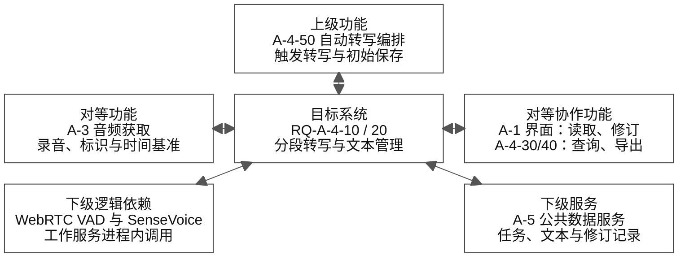
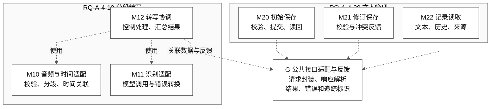
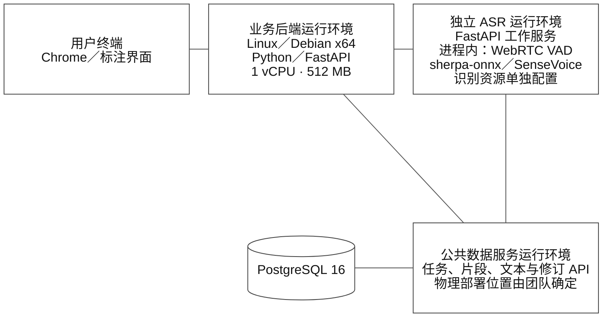
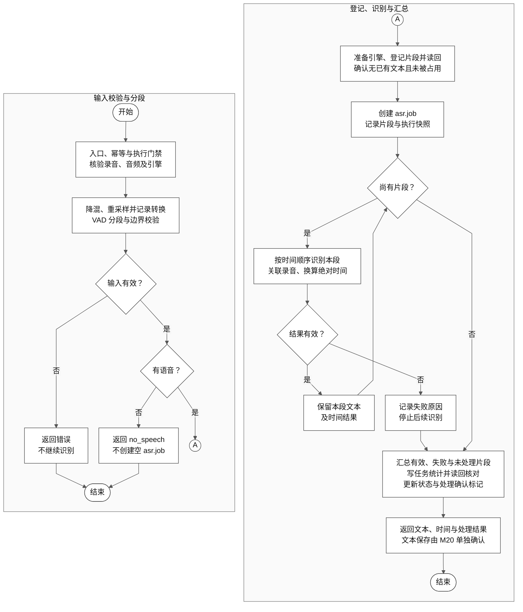
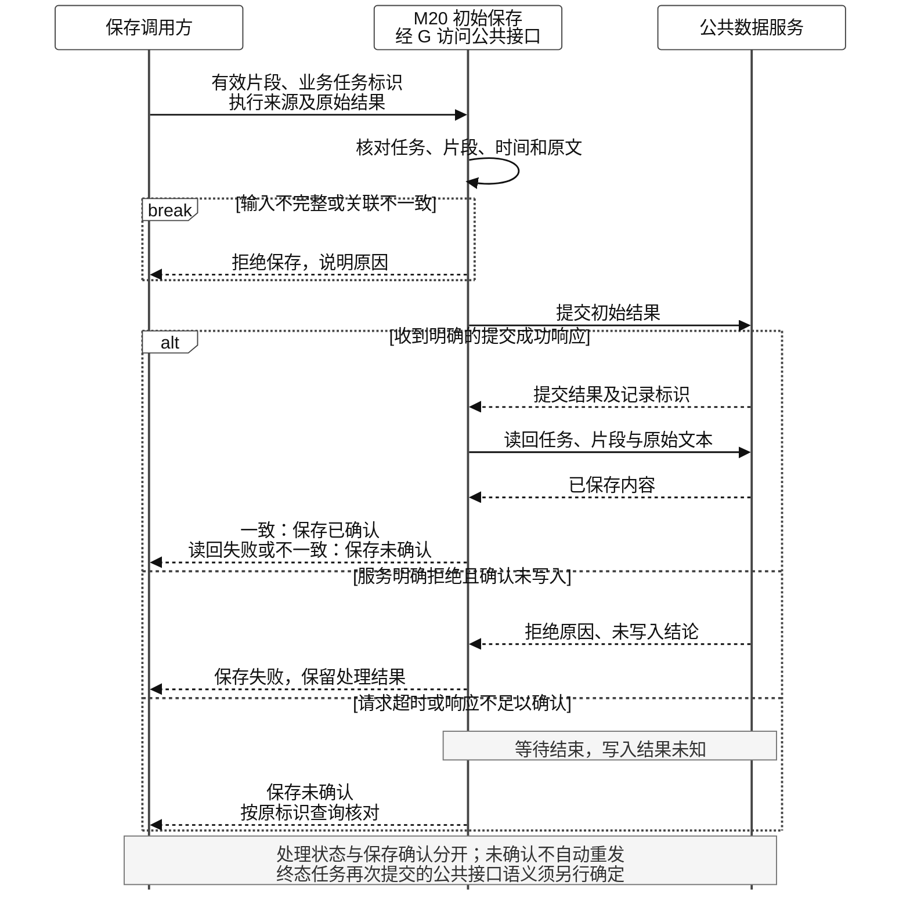
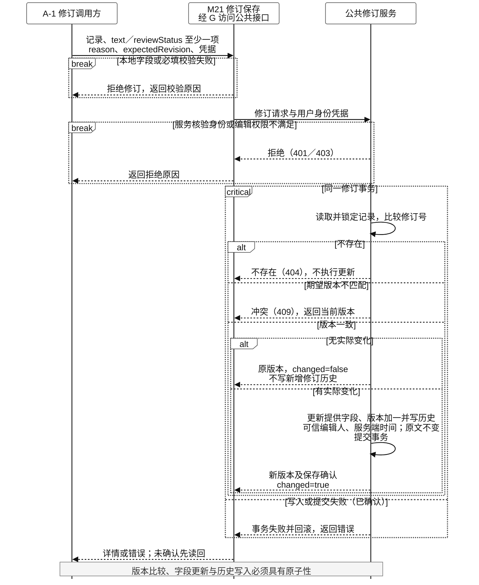
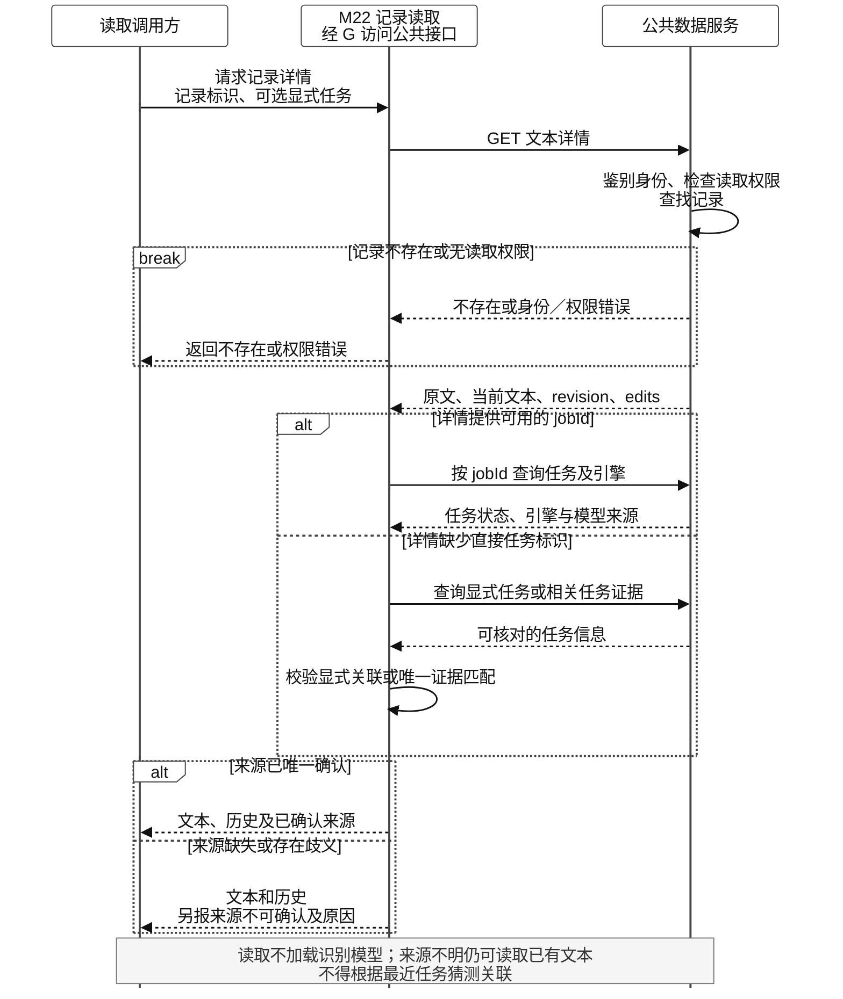
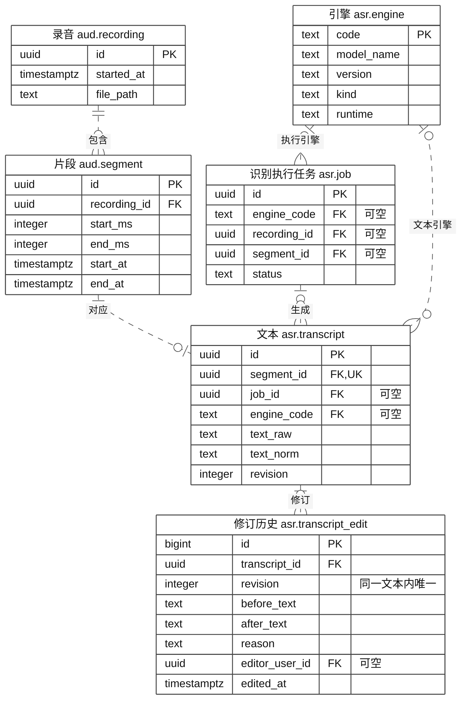

# 可视化ATC地空通话语音标注系统 · 系统设计说明书

V0.9（处理上限与并发承诺修订）

拟制人 李洪（2024141460331）

审核人 待组内评审

批准人 待课程评审

2026年11月3日

## 修订记录

| 版本 | 修订日期 | 修改人 | 修改内容 |
|:---|:---|:---|:---|
| V0.2 | 2026-10-24 | 李洪 | 依据个人需求和公共资料修订接口与运行设计，区分目标设计、个人接口草案及待团队验证的公共行为。 |
| V0.3 | 2026-10-25 | 李洪 | 同步转写、保存、读取和修订四项HTTP操作，明确修订鉴权及可处理录音状态。 |
| V0.4 | 2026-10-29 | 李洪 | 采用教师提供的ATC微调SenseVoice作为识别模型，保留模块结构，更新模型基线与调用说明。 |
| V0.5 | 2026-10-31 | 李洪 | 修订设计逻辑及八张图，明确修订事务、无变化提交、非标识数据关系和模型调用边界，同步Word。 |
| V0.6 | 2026-10-31 | 李洪 | 将图4-1及图5-1至图5-3移入对应流程逻辑小节，补充流程导读，保留图号和设计内容。 |
| V0.7 | 2026-11-03 | 李洪 | 补充文档修订记录，统一Markdown与Word的版本、日期及修订信息。 |
| V0.8 | 2026-11-03 | 李洪 | 对齐模板标题与结构分节；限定转写幂等及模型门禁，补齐容量职责、拒绝恢复及验证设计，同步Word。 |
| V0.9 | 2026-11-03 | 李洪 | 将500段改为可配置原型默认上限，明确超限与分批前提；限定非阻塞承诺，补充边界及负载验证，同步Word。 |

本说明书给出本人负责的RQ-A-4-10（音频分段与转写）和RQ-A-4-20（文本保存与读取）的设计方案，供组内评审、实现和测试使用。设计采用教师提供的ATC微调SenseVoice，按转写、初始保存、修订和读取划分职责，并复用A-3录音与A-5公共数据服务。V0.9将单次处理上限改为部署配置，明确超限反馈与分批处理的接口前提，并将非阻塞承诺限定为操作控制边界；保留九章、附录和八张图，历史修改见修订记录。实现进展和测试结果另见验证记录。

## 1. 引言

### 1.1 编写目的

把需求规格说明书中的用户可见行为细化为可评审的系统设计。读者可以据此确认两个需求的输入、输出、模块责任、公共接口调用顺序和数据留痕方式，并据此安排实现、联调和测试。本文不替代全项目接口说明，也不描述标注界面的交互细节。

### 1.2 背景

项目面向 ATC 地空通话语音标注。A-3提供录音及时间来源，协作功能提供调用、人工修订、查询和展示入口。本人的功能负责将可用录音切分为通话片段、调用识别模型并形成带时间关联的结果，同时将初始文本和协作功能提交的修订保存到公共数据服务，供后续读取。

### 1.3 定义

| **术语** | **本文含义** |
|:---|:---|
| ASR | Automatic Speech Recognition，自动语音识别；本文通过识别适配器调用教师提供的SenseVoice模型。 |
| VAD | Voice Activity Detection，语音活动检测；用于确定录音中的有效语音片段。 |
| UTC | Coordinated Universal Time，协调世界时；绝对时间使用明确的时区，不把本地时间直接当成UTC。 |
| CER / WER | Character / Word Error Rate，字错误率／词错误率；用于和人工参照评价识别结果，不等同于时间保存精度。 |
| 相对时间 | 片段相对于录音起点的 startMs/endMs，单位为整数毫秒。 |
| 绝对时间 | 录音起始时刻加相对偏移后的带时区时间戳，遵循 ISO 8601/UTC。 |
| 处理结果 | 转写过程的 succeeded、partial、failed 或 no_speech；与HTTP响应、元数据确认和文本保存确认分别判断。 |
| 初始保存 | 把自动识别的有效文本及其来源写入公共数据服务。 |
| 修订 | 协作功能提交的新文本及原因；原始文本保留，当前文本和历史记录同步更新。 |
| 执行任务 | asr.job 中的一次识别执行；它与上层业务任务分开表示。 |

### 1.4 参考资料

- 《A4-RQ-A-4-10_20 需求规格说明书（含UML图）》：个人范围和验收口径。

- 《可视化ATC地空通话语音标注系统 需求规格说明书 v1.6》：全项目环境、容量和公共约束。

- 当前公共依据：《A-5-数据表结构》、主仓库 SEPA2026_TeamBlue 中的 A-5 资料及尹凯臣/openapi/README.md；核对日期为2026年10月24日。表结构与通用规则不能单独证明服务已经实现。

- 历史适配依据：P-Blue/openapi 中的 A-3/A-4 接口及 V6/V7 迁移，用于解释现有适配器。与当前主仓库资料冲突时须由接口维护者确认，不自动以历史文件覆盖现行约定。

- 个人实现与草案：主仓库李洪目录下 src/a4_speech、config.example.json、openapi/a4-speech.openapi.json，以及 docs/A4-10-API服务与A5数据映射核对.md。新增转写入口标记为 proposed，尚未成为团队登记接口。

- 教师项目思维导图：开发工具、预处理识别API和目标运行环境。2026年10月29日用户确认交付的 `vhhh_sensevoice.zip` 为教师提供的ATC微调模型；已核验包内文件哈希和本地CPU加载，来源、版本标签及验证范围见[教师模型接入说明](教师ATC微调SenseVoice接入说明.md)。训练数据与质量指标不由模型名称推定。

- 课程《系统设计说明书》模板、结构设计课件，以及 homework/example 中的活动图、时序图、状态图、类图和部署图示例。

## 2. 总体设计

### 2.1 需求规定

#### 2.1.1 系统功能

| **需求** | **设计承担的功能** | **不承担的功能** |
|:---|:---|:---|
| RQ-A-4-10 | 校验音频及时间元数据；必要时适配格式；VAD分段；逐段识别；保留成功、失败和未处理信息；计算相对/绝对时间。 | 采集录音、调度任务、标注界面、时间范围检索、导出和模型训练。 |
| RQ-A-4-20 | 保存初始有效结果；保存协作功能提交的修订；保留原文、当前文本、修订号、原因、编辑人和时间；按标识读取。 | 编辑界面、历史浏览界面、回滚操作及上层业务权限策略。 |

#### 2.1.2 系统性能

##### 2.1.2.1 精度

时间边界以整数毫秒表示，满足0 ≤ startMs < endMs ≤ durationMs；绝对时间只按录音UTC起点加偏移换算一次。生成文本在传输、保存和读取时不得乱码、无提示截断或改变原文。识别质量按语种采用CER或WER，单独核对呼号、数字和分段边界误差；样本及阈值按项目测试与验收方案确定，毫秒级保存精度不代替识别准确度。

##### 2.1.2.2 时间特性要求

识别处理耗时以不超过录音时长两倍为建议目标，分别记录下载、适配、VAD、模型和公共请求耗时，并说明计时范围与模型配置。文本读取参与全项目普通页面或列表流程时，继承10并发用户、常规数据量下95%请求不超过2秒的系统级建议目标；人工标注保存的2秒建议不用于约束整段音频识别。上述目标不作为四项HTTP操作的统一超时时间。

##### 2.1.2.3 可靠性

已确认保存的文本在服务重启后仍可按标识读取，原始文本不得被修订覆盖。修订的版本比较、实际变化判断及历史写入由公共服务原子完成；无变化不升版，冲突不覆盖当前值。超时或提交结果未知时先读回核对，不盲目重发。转写模型不可用或正在处理时，已有记录的读取与修订不占用识别门禁，控制边界见§7.2。

##### 2.1.2.4 灵活性

模型及VAD参数通过配置替换，执行快照保留实际模型身份和参数，不用新配置覆盖历史来源。公共响应新增非必需字段时可忽略未知字段，同时核验必填字段及数据有效性；本模块入站请求仍按§6.2拒绝未定义字段。接口适配集中在公共适配器，调整音频接入或公共服务时保持已有文本的读取含义兼容。

#### 2.1.3 输入输出要求

| **方向** | **主要内容** | **约束** |
|:---|:---|:---|
| 转写输入 | HTTP请求提供 recordingId；businessTaskId 可选；请求头提供认证、幂等键及可选追踪标识。 | 两类标识按UUID校验；音频、元数据、时长及UTC起点由A-3查询取得。 |
| 初始保存输入 | 有效处理结果、任务及片段关联、businessTaskId。 | 独立保存必须提供业务任务标识；组合 run 在转写前预检；正式公共映射待确认。 |
| 转写输出 | 片段标识、文本、相对/绝对时间、模型快照、处理状态、成功/失败/未处理明细。 | partial 只表示识别过程部分成功，不表示所有文本已保存。 |
| 保存输出 | 保存确认、文本标识、修订号或明确失败/未确认结果。 | 未得到明确确认时不报告成功，不自动盲目重试。 |
| 读取输出 | 当前文本、原始文本、修订历史、模型来源和时间关联。 | 已有文本读取不加载识别模型。 |

#### 2.1.4 数据管理能力要求

公共数据服务使用PostgreSQL 16。录音与片段、识别任务、文本、引擎和修订历史分别表示；asr.transcript.segment_id非空且唯一，asr.transcript_edit以(transcript_id, revision)记录历史。初始保存必须带所属业务任务标识，但该标识与asr.job的正式映射目前只作为逻辑关联，待团队确认具体表或外键。

继承需求§3.4：原型阶段片段建议管理规模为10⁵～10⁶条；10 GB为数据库、音频和日志共享的全项目在线空间，结构化数据按年增长预留至少30%余量。达到80%使用率时告警，达到90%时暂停非必要批量下载及新增大文件任务。阈值不构成对已有文本读取、修订和常规小额保存的一律禁用；实际资源不足仍须明确反馈。容量职责、拒绝与恢复设计见§8.2.1、§9.3，验证见§4.12和§5.12。

#### 2.1.5 故障处理要求

输入无效、无语音、单段识别失败、模型不可用、公共服务拒绝、保存未确认、无权限、记录不存在和修订冲突分别反馈。部分成功保留已确认的有效片段，失败和未处理片段单独列出；不会把异常误报为无语音。

#### 2.1.6 其他专门要求

识别模型在独立运行环境中使用。工作服务以 application/problem+json 返回错误，包含中文说明、机器错误码和 requestId；追踪标识与转换记录按第7章保存。原始文本不得被人工修订覆盖。

### 2.2 运行环境

#### 2.2.1 设备

教师项目图规定业务后端采用 Linux/Debian x64、1 vCPU、512 MB，并给出10 GB在线存储空间；ASR识别引擎单独部署。上述业务后端资源不作为独立ASR进程的资源上限。当前识别采用CPU推理，独立环境的内存、线程及吞吐量仍按实测配置；本地测试不等同于Debian目标环境或512 MB预算已通过验收。开发期可在Windows环境验证同一接口。

#### 2.2.2 支持软件

课程开发栈为Python/FastAPI、JavaScript/Node.js及Chrome；公共数据服务使用PostgreSQL 16，服务间通过HTTP(S)和JSON通信。独立识别工作服务采用FastAPI；WebRTC VAD及sherpa-onnx/SenseVoice均在该进程内调用，不另设模型RPC。

| **层次** | **确定的基线** | **证据与适用范围** |
|:---|:---|:---|
| 课程目标 | sherpa-onnx + 教师提供的SenseVoice ATC微调模型。 | 直接接入教师交付的ONNX权重；本人负责处理流程，不再自行训练。 |
| 当前ASR配置 | SenseVoiceSmall-ATC-VHHH INT8，teacher-2025_0706-int8；CPU、英语、ITN=true、greedy search、numThreads=2。 | config.example.json指向models/vhhh-sensevoice-atc-2025_0706/；模型与词表来自教师包。实际文件哈希及运行参数随快照保存；通用版另存对照配置。 |
| 当前VAD配置 | WebRTC；webrtcvad-wheels 2.0.14.post1；20 ms帧、aggressiveness=2、静音合并≤500 ms、合并后最短250 ms、padding=0。 | 参数集中在config.example.json；单服务worker与模型2线程是不同配置。 |

#### 2.2.3 接口

外部调用方可通过本人工作服务的转写、独立保存、读取及修订四项HTTP操作进入对应模块；本人再调用A-3录音/片段服务和公共任务、文本服务。公共数据结构与通用规则以当前主仓库资料为依据，历史接口用于兼容适配；个人新增路径不写成团队已登记契约。第6章分别列出个人入口、公共适配及待确认项。

#### 2.2.4 控制

调用方负责提交请求和展示结果；本人模块控制输入校验、分段循环、结果汇总、保存核对和修订版本提交。编辑人从认证上下文取得，不能由客户端任意指定。

### 2.3 基本设计概念和处理流程

转写、初始保存、修订保存和按标识读取是四个可独立响应的能力。转写完成只代表形成处理结果；保存确认由文本管理模块单独取得；修订提交以当前修订号为依据；读取直接访问已保存文本和历史，不依赖识别模型。

**图2-1 本人功能的架构上下文**

> 说明：按课程第10章上下文图的层级安排：上方为 A-4-50 编排调用方，中间为本人功能及 A-3、A-1、A-4-30/40 对等协作功能，下方为识别引擎与 A-5 公共数据服务。识别引擎是工作服务进程内的逻辑依赖，不表示另设模型RPC；物理部署见图3-1。五组双向关系分别表示编排请求及状态、音频获取、文本交换、识别输入与结果、数据存取请求与结果。

### 2.4 结构

内部结构按职责拆分为音频与时间适配、识别适配、转写协调、初始保存、修订保存和记录读取。公共接口适配器集中处理请求封装、响应解析、错误映射和 requestId 传递；模块之间以明确的数据对象交接，避免由一个控制函数承载所有规则。

**图2-2 本人功能的逻辑模块结构**

> 说明：模块框表示逻辑职责，虚线由使用方指向被依赖模块。四项HTTP操作分别适配至M12、M20、M22和M21，图中模块并非各自独立部署的服务。

### 2.5 功能需求与系统模块的关系

| **需求** | **M10/M11** | **M12** | **M20** | **M21** | **M22** | **G公共适配** |
|:---|:---|:---|:---|:---|:---|:---|
| RQ-A-4-10 分段与转写 | √ | √ |  |  |  | √ |
| RQ-A-4-20 文本保存与读取 |  | √ | √ | √ | √ | √ |
| 统一错误与追踪 |  | √ | √ | √ | √ | √ |

### 2.6 人工处理过程

人工参与点只有协作功能提交修订、确认保存和处理未确认结果。本人模块不替代标注人员决定文本内容；修订原因、期望修订号和认证身份由调用方/公共服务共同提供，公共服务负责原子版本检查。

### 2.7 尚未解决的问题

以下事项须在相关接口定版或系统联合验收前确定，确认后同步接口和数据设计：

- 公共修订服务如何接入可信用户身份，并将权限核验、期望版本比较、实际变化判断、状态及历史更新纳入同一事务或等效原子操作；个人适配器的预读不代替此约束。

- 业务任务与asr.job的正式映射、文本详情是否直接提供jobId，以及缺少直接来源时可接受的唯一匹配证据。

- 完成接口对终态任务再次提交、相同结果重复保存和部分写入的语义，避免把网络重试当作安全的重复写入。

- 独立ASR环境的资源预算、代表性空管样本及质量阈值，由目标环境测量和组内评审确定。

## 3. 系统的结构

### 3.1 组件协作

逻辑模块及层次沿用图2-2与§2.5。自动编排或业务调用方将转写请求交给M12；M12调用M10校验和分段、调用M11识别，并经G公共适配器登记片段、任务及执行元数据。初始文本由M20独立保存；M21处理修订；M22按标识读取。四项HTTP操作分别进入对应分支，读取、保存和修订不获取模型执行锁。

A-3提供录音、片段与时间基准，A-5／公共平台提供任务、文本及修订持久化；A-1及查询、导出功能使用已保存结果。工作服务内部的VAD和ASR是进程内库调用，公共服务通过HTTP(S)／JSON协作。认证、幂等和记录事务的边界分别见§6.2与§7.2。

### 3.2 部署与运行拓扑

系统结构由用户终端、业务运行环境、独立ASR运行环境和公共平台组成。业务环境负责请求编排，并通过HTTP(S)调用独立ASR环境中的FastAPI工作服务；服务内部完成转写协调、WebRTC分段及sherpa-onnx/SenseVoice推理。公共接口适配器负责片段、任务与文本读写。公共平台保存录音、片段、任务、文本和修订历史，其物理位置与团队接口登记尚待确认。

**图3-1 目标部署概要**

> 说明：图中用户终端、业务后端、ASR工作服务与公共数据服务之间均使用HTTP(S)／JSON；公共服务至PostgreSQL使用原生连接。工作服务内部的VAD和ASR为库调用。转写HTTP入口是个人草案，ASR资源独立配置，公共平台位置待团队确认。

## 4. 模块1（RQ-A-4-10 分段转写）设计说明

### 4.1 模块描述

接收可追溯的录音及时间依据，完成音频校验、VAD 分段、逐段识别和时间关联，形成可供文本管理模块保存的处理结果。

### 4.2 功能

校验格式、采样率、声道、时长和时间起点；必要时转换为识别所需格式；切分语音片段；逐段调用识别适配器；汇总成功、失败、未处理和无语音结果。

### 4.3 性能

记录录音时长、各阶段耗时和资源测量点。识别处理耗时以录音时长两倍为建议目标；实际 CER/WER、呼号和数字准确性由代表性样本和人工参照评价。

### 4.4 输入项

HTTP请求仅要求recordingId，businessTaskId可选；二者按UUID校验。服务从A-3取得音频、durationMs、带时区startedAt和来源元数据，仅接受storageState为stored或verified的录音。认证、幂等及追踪请求头见§6.2。初始保存或组合run另要求业务任务标识。

### 4.5 输出项

返回status、jobId、计数、transcripts、失败明细和未处理片段标识。每条有效转写含recordingId、segmentId、startMs/endMs、UTC startAt/endAt、生成原文textRaw及language。sequenceNo属于公共片段字段，不承诺每条转写响应均携带。模型快照、转换记录及处理元数据确认状态见第6、7章；本步骤不发布转写文本。

### 4.6 设计方法（算法）

先查询stored或verified录音，下载并校验身份、音频属性和时长，解码并记录真实转换动作；冻结配置，核对VAD与ASR的公共引擎登记。音频降混为单声道并适配16 kHz；WebRTC按20 ms帧检测，合并短静音后筛除短片段，校验毫秒边界。VAD完成后先按§4.11核验本次片段数；通过后再准备ASR模型，登记并读回片段，排除已有文本或忙片段，再创建asr.job。按时间顺序识别，遇首个失败即停止；此前有效结果、失败段和未处理段分别保留。最后写任务统计并读回核对；元数据确认与文本保存分开。参数和模型基线见§2.2.2。

时间换算只执行一次。设录音UTC起点为 t₀，则 startAt = t₀ + startMs / 1000 秒，endAt = t₀ + endMs / 1000 秒，且 0 ≤ startMs < endMs ≤ durationMs。以16 kHz、20 ms帧为例，每帧采样数 N = 16000 × 0.020 = 320；采样位置 i 对应相对偏移 1000i / 16000 毫秒，转换为整数毫秒后再次校验边界。缺少可信时区或起点时拒绝绝对时间换算，不重复叠加已有片段UTC时间。

### 4.7 流程逻辑

VAD未检出语音时返回no_speech，不创建空asr.job，也不创建空文本。存在片段时，全部识别成功为succeeded；已取得有效文本而后续失败为partial；无有效文本且识别失败为failed。HTTP 200只表示返回结构化结果，调用方还需分别判断status、processingRecorded和saveConfirmed/saveStatus。no_speech是本地处理结果，不向公共任务表新增该枚举。完整处理流程见图4-1。

**图4-1 分段转写活动流程**

> 说明：图中两个圆形A是同一流程连接符，左列“有语音”分支接续右列。图中“输入有效”判断包含边界与可配置片段上限校验。无语音不创建空识别任务；有语音时先登记片段、创建任务，再识别和确认元数据。首个识别失败后停止，保留有效、失败和未处理信息；文本保存由M20另行执行。

### 4.8 接口

入口为POST /api/v1/a4/speech/transcribe（个人草案）。出站调用A-3录音/片段及公共任务服务；VAD和ASR由进程内适配器调用。HTTP适配器负责认证、输入映射、同步控制、Problem JSON及请求标识；公共接口适配器负责上游认证、超时和错误转换。

### 4.9 存储分配

A-4-10登记aud.segment，创建asr.job并写执行快照和处理统计；不写asr.transcript文本。A-4-20再提交有效文本并取得保存确认。params/stats中的a4_10_20扩展保留录音、目标片段、快照及可选业务任务关联；JSON逻辑关联不能替代正式外键。本地持久回执保留幂等键与任务关联，不另建公共业务数据库。

### 4.10 注释设计

标明毫秒及UTC换算、四类处理结果、首个失败片段后的停止策略、模型快照来源和文本保存边界。转换记录与追踪字段的含义集中定义于§7.3；保存及重放不得把当前调用标识冒充原始处理标识。

### 4.11 限制条件

范围按§2.1.1执行。单次处理上限设计为部署配置项maxSegments，取正整数，原型默认500段；服务启动时校验配置，每次处理冻结本次上限并记录上限值与实际片段数。该值用于控制单次资源开销，可按代表性录音和目标ASR资源调整，不作为需求规定的固定上限，也不代表公共库的总管理容量。

VAD完成后，若片段数超过本次上限，在登记片段、新建识别任务和执行推理前返回422/JOB_SEGMENT_LIMIT，反馈实际数量、上限及请求标识，不截断片段或创建空文本。由编排方保留录音标识并安排后续处理；运维可在资源评估后调整上限。分批处理须由A-3及编排接口提供可追溯输入并约定源录音、时间与片段关联；当前转写入口不接收时间范围或片段列表，不自行把同一录音拆成多次请求，也不靠更换幂等键反复提交。

仅转写分支采用同步处理及单进程模型互斥，不提供内部任务队列或集群级保护；读取、保存和修订不占用该模型锁。公共记录的一致性由提供方的原子约束保证，资源负载与响应时间按§7.2分别评价。

### 4.12 测试计划

按单元验证、真实模型验证和公共服务联调依次开展，由本人准备驱动及固定输入，A-3/A-5负责人配合录音、片段和任务接口；错误与超时由可控桩注入。覆盖静音无任务、损坏音频、转换记录、边界/UTC、引擎不匹配、片段冲突、首段失败与部分成功、任务统计未确认、HTTP鉴权/幂等/429、保存与读回。预期分别为无空任务、明确错误、时间换算一致、失败后停止且保留有效子集、未确认状态独立反馈。模型质量另用固定空管样本及人工参照统计CER/WER、呼号/数字和耗时；本地模拟、真实CPU推理、团队服务联调分项记录，不以HTTP成功代替质量或验收。

增加两类控制场景：转写占用模型时并发发起读取、保存或修订，预期其他分支不校验转写幂等键、不因模型占用返回429；通过A-3／公共服务桩注入容量告警和资源拒绝，预期80%告警不自动阻断正常请求，非必要新增大文件任务被暂停时明确反馈，不创建空文本或覆盖已保存结果。A-3／A-5负责人配合核对平台实际阈值，本人负责请求驱动、反馈及原记录保护验证。

处理上限按N−1、N、N+1个片段验证，N为本次配置；同时覆盖默认500、调整后的正整数及非正整数或非整数配置。预期合法配置下前两组进入正常流程，超限在公共写入和推理前明确拒绝，非法配置在启动校验时拒绝；不能为通过检查而丢弃片段、改变录音标识或平移时间。分批入口未确认时，只反馈超限及后续安排，不宣称已经自动分批。

并发场景分别记录其他分支是否等待模型锁、响应时间及错误类型，并说明CPU、内存、线程和上游负载。共享资源导致的变慢、超时或不可用单独统计，不将其解释为模型锁占用；性能目标按§2.1.2.2的测试负载评价。

### 4.13 尚未解决的问题

教师ATC模型已接入本地默认流程；代表性VHHH样本及可核验人工参照、质量阈值和目标ASR资源仍需补充。已有公开英语ATC数据可作为基线，既有VHHH片段机器稿不能作为准确率验收。公共引擎登记须与教师模型身份一致；登记、片段并发及任务完成语义需真实服务确认。 maxSegments的合适取值需按目标资源与录音实测确定；超限后的分批输入及来源关联须与A-3、编排方确认。

## 5. 模块2（RQ-A-4-20 文本管理）设计说明

### 5.1 模块描述

管理自动转写文本的初始保存、协作功能提交的人工修订以及按标识读取，保证原始文本、当前有效文本和历史记录可追溯。

### 5.2 功能

接收有效片段；核对任务、片段、时间和原文；调用公共保存接口；处理未确认结果；接收带原因和期望修订号的人工修订；读取当前、原始、历史和来源信息。

### 5.3 性能

保存确认后文本可持久读取；重启后仍能读取；文本不得乱码、截断或覆盖原始文本。响应时间和并发目标按全项目联合测试确定。

### 5.4 输入项

初始结果、录音/片段/执行任务标识、模型快照、请求标识；修订请求中的text或reviewStatus、reason、expectedRevision和认证上下文；读取请求中的唯一文本标识及可选jobId。

### 5.5 输出项

保存成功及文本标识、修订号和状态；明确拒绝、失败或未确认；读取返回原始文本、当前文本、revision、edits、模型来源、时间关联和处理结果。

### 5.6 设计方法（算法）

初始保存先筛选有效结果，再调用公共服务并读回核对；修订先校验权限、待修订字段、reason和期望版本，由公共服务在同一事务中比较版本与实际变化；无变化保留原版本并返回changed=false，有变化才更新提供的字段、递增版本并同步历史和状态；读取按唯一标识获取，不加载识别模型。

### 5.7 流程逻辑

初始保存、修订保存和读取分别处理成功、失败、冲突、无权限、记录不存在和结果未确认。保存未确认时保留处理结果，按标识读回或人工核对后再决定是否继续，不自动盲目重发。

#### 5.7.1 初始保存流程

初始保存先核对有效片段、业务任务、时间和原文，再提交公共数据服务并读回确认；明确拒绝与结果未确认分别反馈，流程见图5-1。

**图5-1 初始转写结果的独立保存时序**

> 说明：初始保存要求业务任务标识，并对有效子集执行提交和读回。保存确认与转写结果分开，未确认时不重发；公共终态任务再次提交及原文映射仍需联调。

#### 5.7.2 人工修订流程

人工修订先校验字段与权限，再由公共服务在同一事务中比较期望版本和实际变化；有变化时同步更新当前值、版本和历史，无变化保持原版本，流程见图5-2。

**图5-2 人工修订保存时序（目标设计）**

> 说明：text和reviewStatus至少提交一项。权限核验后，在同一并发保护范围比较版本和实际变化；无变化不升版本、不新增历史，有变化才原子更新。写入失败回滚；响应丢失或提交状态未知时先读回核对。

#### 5.7.3 按标识读取流程

读取按文本标识取得当前文本、原文及历史，优先通过明确的jobId核对来源；来源缺失或有歧义时单独说明，流程见图5-3。

**图5-3 按标识读取文本并核对来源**

> 说明：读取权限与记录存在性在返回详情前核对。优先使用明确的 jobId；缺少直接来源时只接受唯一可核对的匹配，不能按最近任务猜测。

### 5.8 接口

工作接口采用POST /api/v1/a4/speech/results/save，以及GET/PATCH /api/v1/a4/transcripts/{transcriptId}。个人保存出口接收完整处理结果；读取和修订共用文本标识路径。PATCH要求reason、expectedRevision及用户Bearer，具体请求、返回和异常见§6.2。出站初始保存仍适配公共任务完成接口，修订转发用户凭据；个人出口不等于公共上游已发布或已验收。

### 5.9 存储分配

使用公共 asr.transcript、asr.transcript_edit、asr.job、asr.engine 等结构。text_raw 保留自动原文，text_norm 表示当前有效文本；同一片段的文本唯一性和修订历史唯一性由公共服务保证。

### 5.10 注释设计

接口说明注明原始/当前文本区别、revision 的递增语义、编辑人来源、服务端时间、保存确认和未确认核对方法。

### 5.11 限制条件

范围按§2.1.1执行。调用方必须遵循认证与公共服务访问控制；人工修订需要可信身份和公共服务的原子版本检查，不能由客户端先读后写代替。

### 5.12 测试计划

测试按适配器单元验证、公共服务集成和目标环境回归依次开展。本人负责测试驱动、输入及预期结果，公共服务负责人配合权限、事务、重启和恢复验证；先用可控桩覆盖拒绝与超时，再连接同一测试数据集检查持久化。

| **测试输入/条件** | **预期结果** |
|:---|:---|
| 完整有效结果、部分成功结果 | 只保存有效子集；读回原文、片段、任务及时间一致；处理状态不变。 |
| 缺少原因、关联无效、无权限 | 拒绝提交，已有文本及历史不变。 |
| 相同版本且文本或状态实际改变 | 版本加一，同步更新当前值与历史，text_raw不变。 |
| 相同版本且提交值均未改变 | 核验权限后changed=false，版本和历史条数不变。 |
| 两个请求使用同一期望版本 | 至多一个实际变更成功；另一请求冲突，不覆盖新版本。 |
| 超时、响应丢失、重启或公共库恢复 | 先读回核对；未确认不重发；确认后仍能按标识读取。 |
| 转写正在处理，同时读取、保存或修订其他合法记录 | 不获取识别门禁、不要求转写幂等键；保存及修订仍按任务、记录和期望版本进行原子校验。响应时间与资源负载另行记录，不承诺任意负载下固定时限。 |
| 平台80%告警；A-3在90%阈值暂停非必要新增大文件任务 | 告警不等于全部文本操作禁用；对应任务拒绝明确反馈，已有文本读取和合法修订可独立受理。 |
| 公共服务明确拒绝资源写入，或写入后响应丢失 | 明确拒绝时不报告成功、原记录及历史不变；是否提交未知时先读回核对，不自动重发。 |
| 公共平台解除容量限制或完成恢复后再次按标识读取 | 核对当前文本、原文、修订号和留痕一致；恢复准入遵循平台策略，不自行删除记录或另造恢复阈值。 |

### 5.13 尚未解决的问题

公共服务的用户身份来源、原子修订操作、历史与复核状态同步，以及文本所属业务任务映射须在接口定版时确认。兼容适配不得削弱原文保护、版本比较和留痕约束；必要能力缺失时由对应提供方补齐。

## 6. 接口设计

### 6.1 用户接口

用户终端通过协作功能发起转写、保存、修订和读取请求。本人模块向调用方返回结构化状态和中文可读说明；不在本说明书中规定页面布局。

### 6.2 外部接口

| **接口对象** | **方向/用途** | **关键约束** |
|:---|:---|:---|
| 调用方→本人工作服务 | 转写、独立保存、读取与修订四项同步HTTP操作。 | 四项均用X-Api-Key；仅转写要求幂等键，修订另需用户Bearer；转写不保存文本。 |
| 本人→A-3录音/片段服务 | 读取stored或verified录音及音频，登记片段并读回。 | 校验身份、起点、时长与边界；不重复平移时间。 |
| 本人→公共任务/文本服务 | 核对引擎、建任务及统计；M20另行保存文本，M22读取。 | 出站认证独立配置；真实持久化、来源外键和重复提交语义待联调。 |

#### 6.2.1 A-4-10 转写工作接口（个人草案）

POST /api/v1/a4/speech/transcribe采用FastAPI同步工作接口，OpenAPI标记为proposed，须与A-4-50及接口维护者评审后登记。请求为application/json，仅接收recordingId（必填UUID）和businessTaskId（可选UUID），其他字段拒绝。原音频与时间属性由A-3取得。接口同步返回，不以202表示排队。

| **请求头** | **约定** | **处理规则** |
|:---|:---|:---|
| X-Api-Key | 工作服务入站密钥，对应A4_SERVICE_API_KEY。 | 与访问上游的A4_API_KEY分开；缺失或不匹配返回401。 |
| Idempotency-Key | 必填；1—64个可打印ASCII字符；不能全为空白。 | 用于本地持久回执；相同键不盲目重新推理，冲突与未知状态见§7.2。 |
| X-Request-Id | 可选；1—128个允许的安全ASCII字符。 | 合法则透传，未提供则生成；不合法返回400，响应携带当前请求标识。 |

HTTP 200响应包含schemaVersion、recordingId、可空businessTaskId/jobId、status、processedSegments/failedSegments、transcripts、failedSegmentsDetails、unprocessedSegmentIds、traceId及保存状态。targetSegmentIds等扩展按结果分支返回，不要求静音结果携带。每条transcripts包含§4.5所列关联、时间、textRaw和language。新转写返回saveConfirmed=false、saveStatus=not_requested；回放已确认保存的历史结果可保留原保存状态。

status仅取succeeded、partial、failed、no_speech。processingRecorded扩展用于说明任务结果元数据是否已确认，false时不得宣称写入已完成；该字段不是文本保存确认。executionSnapshot、audioProcessing和processingTraceId等诊断字段按已有证据返回，旧历史缺失时可省略。/health仅检查服务存活，/docs和/openapi.json用于草案评审，不代表上游已就绪。

#### 6.2.2 独立保存工作接口

POST /api/v1/a4/speech/results/save为独立保存接口，标记为proposed。请求为application/json，结构为 {"result": 完整转写结果对象}，拒绝其他顶层字段。result.businessTaskId必须为UUID字符串，可在保存未绑定结果时补入；缺失或格式错误在HTTP入口返回400，不提交上游写入。业务任务真实存在性及正式外键仍待验证。

使用X-Api-Key，不要求转写用的Idempotency-Key。服务核验任务、片段、原文摘要和执行快照后，适配公共完成接口保存有效子集并逐项读回，不重新推理。HTTP 200返回recordingId、jobId、businessTaskId、transcripts及saveConfirmed=true、saveStatus=confirmed；未确认返回明确错误，不盲目重发。确认范围限于本次上游读回，不能代替真实数据库验收。

#### 6.2.3 按标识读取接口

GET /api/v1/a4/transcripts/{transcriptId}为按标识读取接口，标记为local-compatible-revision。路径transcriptId为必填UUID，可选查询jobId也按UUID校验；无请求体，使用X-Api-Key。读取直接访问公共文本、历史和来源，不加载识别模型；有明确jobId时优先使用，无直接来源时仅接受唯一可核对匹配。

HTTP 200返回id、segmentId、recordingId、text、不可变textRaw、revision、reviewStatus、isEdited、edits及相对/UTC时间。jobId保留公共服务报告的真实关联，可为null；上下文核验来源另用resolvedJobId表示，不冒充外键。reviewHistoryStatus按实际返回recorded、partial、not_exposed或not_applicable，不补造审核历史。

#### 6.2.4 人工修订接口

PATCH /api/v1/a4/transcripts/{transcriptId}为人工修订接口，标记为local-compatible-revision。路径为UUID；JSON必填expectedRevision（整数≥1）、reason（1—200字符且非全空白），并至少提供text或reviewStatus之一。text最长4000字符；状态沿用unreviewed、accepted、rejected、needs_review、skipped，拒绝其他字段及客户端自报editorUserId。

修订同时要求X-Api-Key与Authorization: Bearer用户凭据；出站移除服务密钥并转发用户Bearer，由实际提供方鉴权和记录真实编辑者。仅改审核状态时读取真实当前text补入历史PATCH，保留调用方expectedRevision和reason。HTTP 200返回与读取一致的详情；无变化提交仍核验编辑权限，返回原版本及changed=false。原子版本保护须由实际提供方核验，不以本地预读替代。

四项操作均支持可选X-Request-Id，错误使用application/problem+json，包含status、code、requestId等字段及中文说明。保存/读取/修订按分支返回400参数错误、401凭据无效、403无权限、404不存在、409版本冲突或未确认、422来源或业务校验失败、500内部异常、502上游异常；服务未就绪为503。修订超时或读回不能证实成功时返回502/REVISION_UNCONFIRMED，先GET核对版本和留痕，不自动重发。转写另有429忙状态，其错误范围见§4.12及§6.4。

#### 6.2.5 公共服务适配与待确认项

公共规则按§1.4的来源层次执行。当前保存适配沿用历史任务完成接口，发送transcripts\[\].text；新工作接口返回textRaw，两者处于不同契约层。真实服务是否将text写入text_raw、是否正确关联asr.transcript.job_id、是否允许终态任务再次完成并保存文本，均须用真实读回核验。公共路径以接口维护者确认的发布版本为准。

A-3/A-5协作顺序为：查询与下载录音→核对引擎→VAD→登记并读回片段→检查已有文本/忙状态→创建识别任务→识别→完成任务统计并读回。A-4-20随后单独提交有效文本。公共权限、事务及并发保护由对应服务实现和验证，个人适配器的前置查询不构成数据库原子保证。

### 6.3 内部接口

| **模块** | **输入** | **输出** |
|:---|:---|:---|
| M10 音频与时间适配 | 录音内容、元数据、startedAt | 可识别音频、合法边界和时间换算对象 |
| M11 识别适配 | 单个语音片段、模型配置 | 文本、模型快照或错误 |
| M12 转写协调 | HTTP/本地请求和适配结果 | 处理结果、片段/任务关联与元数据确认状态 |
| M20/M21/M22 文本管理 | 保存/修订/读取请求 | 保存确认、冲突或文本详情 |

### 6.4 接口字段与错误映射

| **字段/状态** | **含义** | **反馈规则** |
|:---|:---|:---|
| startMs/endMs | 片段相对录音起点的整数毫秒 | 边界不合法返回输入错误 |
| startedAt；startAt/endAt | 前者为录音起点，后者为片段UTC起止时间 | 源时间缺失或时区不明时拒绝换算 |
| textRaw；当前文本 | textRaw为本次生成原文；当前文本含人工修订后的有效值 | 两者不能同义化；人工修订保留原文 |
| revision/expectedRevision | 当前版本/提交依据 | 不一致返回 409，数据保持不变 |
| status；保存状态 | 处理结果与saveConfirmed/saveStatus独立 | HTTP 200不等于全部识别、元数据或文本保存成功 |
| Problem JSON | 媒体类型application/problem+json | 工作服务必需type、title、status、code、requestId；另附中文detail和追踪字段 |

JSON字段采用camelCase，数据库列采用snake_case，下表说明映射层次而非要求调用方提交SQL列名。引擎code为字符串，其余关联标识按各公共契约采用UUID。

| **JSON或业务字段** | **数据库落点** | **映射说明** |
|:---|:---|:---|
| recordingId；sequenceNo | aud.segment.recording_id；sequence_no | 序号由公共片段接口定义，不是本转写响应每项必需字段。 |
| startMs/endMs | aud.segment.start_ms/end_ms | 整数毫秒；startAt/endAt由录音UTC起点换算。 |
| textRaw；历史提交text | asr.transcript.text_raw | 新转写只返回原文；实际保存映射须由公共服务读回验证。 |
| 当前有效文本；revision | text_norm；revision；transcript_edit | 修订更新当前文本并留历史，不覆盖text_raw。 |
| businessTaskId | job.params/stats.a4_10_20逻辑扩展 | 当前不是已确认的业务任务外键。 |

## 7. 运行设计

### 7.1 运行模块组合

一次完整调用可组合为“转写→结果展示/确认→独立保存”；读取和修订可脱离转写单独运行，不加载识别模型。在工作服务、公共数据服务及所需资源可用的前提下，即使模型不可用，仍可读取和修订已有文本；工作服务整体退出时须先恢复服务。

### 7.2 运行控制

#### 7.2.1 共同校验与并发边界

各项HTTP操作共同建立追踪上下文、核验X-Api-Key并校验本操作的路径、请求头和请求字段。只有转写要求Idempotency-Key及模型执行互斥；人工修订另需可信用户Bearer。各分支按下表执行，不把识别门禁扩展到文本管理。

| **操作** | **校验要求** | **并发控制** | **结果与忙状态** |
|:---|:---|:---|:---|
| 转写 | 服务密钥、录音标识、幂等键及可选追踪标识。 | 仅此分支申请单进程模型执行锁，并使用持久回执核对同一处理；公共片段与任务占用仍由提供方原子保证。 | 模型忙时在核心受理前返回429/SERVICE_BUSY及Retry-After: 1，不排队。 |
| 初始保存 | 服务密钥、完整结果及业务任务标识；不要求转写幂等键。 | 不获取模型锁；由公共服务约束任务／片段占用及重复写入，保存后读回核对。 | 拒绝、冲突或未确认分别反馈；不因模型忙返回429/SERVICE_BUSY。 |
| 按标识读取 | 服务密钥、文本标识及可选jobId。 | 不获取模型锁、不要求转写幂等键；按授权读取已有记录及来源。 | 不存在、上游失败分别反馈；不等待识别完成。 |
| 人工修订 | 服务密钥、用户Bearer、reason、expectedRevision及待修改字段。 | 不获取模型锁；公共服务在同一事务或等效原子操作内核验权限、版本、变化并更新历史。 | 版本冲突返回409；无变化保留原版本；结果未确认先GET核对。 |

耗时识别在受控工作线程或等效执行上下文中运行，HTTP受理层不得因同步推理占用事件循环而阻断其他分支。模型锁只用于转写分支；保存／修订可以因同一任务或记录的数据竞争等待或冲突，但不等待无关录音的模型锁。公共数据库的一致性由其事务或等效原子操作保证。

独立受理规定操作控制边界，不承诺任意负载下立即响应。CPU、内存、工作线程、网络和公共数据服务仍可能形成竞争，造成变慢、超时或不可用；这些情况按实际原因反馈，不能统一报为429/SERVICE_BUSY。部署时按目标负载配置识别线程和请求超时，记录文本操作延迟并按§2.1.2.2评价；调整资源配置不取消权限、版本或原文保护。

#### 7.2.2 转写回执与恢复

一个Uvicorn工作进程共享一个模型实例；单worker与模型CPU线程数为不同配置。转写忙状态的Retry-After只提供退避提示，不表示允许重复识别；调用方仍须按相同幂等语义核对。当前执行保护仅覆盖单进程，多实例共享锁及公共服务幂等须由团队另行约定。

| **回执情形** | **控制规则** |
|:---|:---|
| 首次转写请求 | 受理后保存本地持久回执，关联recordingId和幂等键；公共任务创建后补记jobId。 |
| 相同键、不同录音 | 返回幂等冲突；不切换录音或创建新推理。 |
| 同一处理已有回执 | 查询既有任务，不盲目重跑；保存已确认的成功／部分成功结果可读回。 |
| 回执无任务号或结果未确认 | 反馈未知／冲突并核对；未保存的重复结果按SAVE_UNCONFIRMED等具体错误返回409。 |
| 任务元数据写入异常 | 先尝试按标识读回；仍未确认时保留处理结果并标记processingRecorded=false。 |

文本保存和修订的未确认结果分别按§5.7与§6.2处理，不直接套用转写回执或重新触发模型。

### 7.3 运行时间

| **环节** | **测量内容** | **记录方式** |
|:---|:---|:---|
| 处理（适配/VAD/识别） | 转换和识别耗时、片段数、模型版本、失败数、内存峰值 | 请求日志、任务 stats 与本地测试记录 |
| 持久化（保存/修订/读取） | 公共请求耗时、确认状态、revision、是否加载模型 | requestId、响应状态、读回核对和运行日志 |

设计测量要求为分开统计音频下载/适配、VAD、ASR及公共请求，并测量内存峰值。操作级日志记录durationMs，阶段耗时及内存测量由相应测量点和测试记录提供。推理CPU线程数使用配置值2，单worker不表示单模型线程；独立ASR内存与实时率仍需实测。

| **记录项** | **来源与存续规则** |
|:---|:---|
| requestId / traceId | 关联当前调用链及日志；合法X-Request-Id透传，未提供时生成，非法返回400。同一次调用内嵌套操作共用当前标识；新保存、读取或重放调用建立自己的当前标识。 |
| processingTraceId | 保留原始处理的追踪标识；回放不得替换为当前读取请求标识。 |
| upstreamRequestId | 单独保留上游返回标识，便于对应上游日志，不覆盖当前requestId。 |
| 日志 | 使用UTC时间、事件码及受限的录音/任务/请求关联；不记录密钥或完整敏感载荷。 |
| audioProcessing | 记录原始与目标采样率、声道、采样数、时长，以及实际降混/重采样动作，随结果元数据保存并支持读回。 |
| 旧历史缺字段 | audioProcessing、processingTraceId等无证据时缺省；不补造转换动作或来源。 |

## 8. 系统数据结构设计

### 8.1 逻辑结构设计要点

录音包含多个有序片段；片段最多对应一条当前文本；识别任务可关联多个文本；文本可包含多条修订历史；文本和任务可引用识别引擎。业务任务是上层概念，尚未确认具体表，因此图中只标逻辑来源，不画成已确定外键。

**图8-1 本人功能使用的局部数据关系**

> 说明：表结构列明的关联与业务任务逻辑扩展分开表达；外键实际写入仍需真实服务验证。revision以同一文本为范围唯一，FK表示外键。虚线表示非标识关系：子表有独立主键，图中外键不参与子表主键；两端符号单独表达基数。

### 8.2 物理结构设计要点

| **结构** | **关键字段/约束** | **用途** |
|:---|:---|:---|
| aud.recording | id、started_at、duration_ms、音频属性 | 保存录音身份、起点和时长 |
| aud.segment | recording_id、sequence_no、start_ms、end_ms | 保存不重叠片段及相对边界 |
| asr.job | id、recording_id/segment_id、engine_code、status、params/stats | 保存识别执行状态和统计 |
| asr.transcript | id、segment_id UNIQUE、job_id、engine_code、text_raw、text_norm、revision | 保存当前文本及来源 |
| asr.transcript_edit | transcript_id、revision、before/after_text、editor_user_id、edited_at | 保存逐次修订留痕 |
| asr.engine | code、model_name、version、kind/runtime | 描述模型和运行时 |

#### 8.2.1 容量与保留策略

容量口径统一采用§2.1.4，不为本模块单独重复分配10 GB。片段规模及至少30%年增长余量纳入公共数据规划；80%为告警阈值，90%暂停范围限于非必要批量下载及新增大文件任务。平台的容量监测、告警、配额反馈和恢复准入由公共能力承接，具体执行组件在团队接口定版时确认。

| **责任方** | **设计职责** | **本模块交接与保护** |
|:---|:---|:---|
| A-5／公共平台 | 汇总数据库、音频和日志占用；维护容量核算、余量、80%告警及90%限制策略；数据库写入拒绝与事务失败须明确返回。 | 本模块沿用公共错误映射反馈资源原因及追踪标识，保留已生成结果；实际写入成功与否不明时先读回。 |
| A-3 | 按平台策略暂停非必要批量下载及新增大文件任务，维护录音文件保留、归档和可读取引用。 | 本模块不绕过下载限制；已存在录音是否允许读取按当前公共策略判断，不把阈值解释为删除录音或全部停读。 |
| RQ-A-4-10／20 | 校验处理上限，反馈资源不足导致的处理或读写失败；不代替平台监控、不擅自清理或重建公共数据。 | 保护原文、当前文本、关联及历史；资源恢复后按标识核对，不通过重跑模型覆盖旧结果。 |

数据访问继续通过公共服务鉴权；容量不足不绕过权限、唯一约束或修订事务。保留、归档、清理由A-3／A-5按项目规则执行，恢复后核对方法见§9.2—9.3。

### 8.3 数据结构与程序的关系

| **数据结构** | **读取/写入模块** |
|:---|:---|
| aud.recording / aud.segment | M10/M12读取录音；M12登记并回读片段 |
| asr.job / asr.engine | M11/M12读取引擎；M12创建任务及写处理统计；M22读取来源 |
| asr.transcript | M20 初始保存、M21 修订保存、M22 记录读取 |
| asr.transcript_edit | M21 修订保存、M22 记录读取 |

## 9. 系统出错处理设计

### 9.1 出错信息

| **错误场景** | **对调用方的反馈** | **数据处理** |
|:---|:---|:---|
| 请求头/格式无效；语义校验失败 | 分别400；422，附具体code及中文说明 | 拒绝无效请求；不创建转写文本。 |
| 未认证 | 401 UNAUTHORIZED | 工作服务核验入站密钥。 |
| 已认证但无权限 | 403及上游错误码 | 修订转发用户Bearer；实际编辑权限由公共提供方校验，鉴权结果与编辑者由该服务提供。 |
| 记录不存在 | 404及具体错误码 | 明确的上游不存在映射404并保留其code；本地不存在路由使用NOT_FOUND。 |
| 幂等/保存未确认/修订冲突 | 409及具体错误码；修订目标反馈当前版本 | 不重跑或盲重发；修订冲突应保持原数据。 |
| 转写模型忙 | 429 SERVICE_BUSY；Retry-After: 1 | 仅转写在核心受理前拒绝；读取、保存和修订不共用此门禁。 |
| 上游异常；模型/配置不可用 | 通常502；503；未预期内部异常500 | 返回Problem JSON；上游标识另存；避免把异常当无语音。 |
| 无语音/识别失败/部分成功 | 结构化结果的no_speech/failed/partial | HTTP 200不保证业务成功；保留有效、失败与未处理信息。 |
| 元数据或文本保存未确认 | 分别检查processingRecorded与saveConfirmed/saveStatus | 按标识核对，不将本地处理结果冒充持久化确认。 |
| 上游容量限制或实际资源不足 | 按既有上游异常／服务不可用映射返回502或503，说明资源原因并保留上游code及requestId。 | 不当作429模型忙；明确拒绝时不报告成功，提交状态未知时转入未确认核对。 |

错误响应使用application/problem+json，并包含type、title、status、code、requestId及中文说明。工作服务保留上游400/401/403/404/409/422，其他HTTP异常通常映射502。用户Bearer由工作服务转发；权限、事务及持久化按公共服务契约验证。详细映射以个人OpenAPI草案和适配器为准。

容量告警本身不作为失败；只有实际拒绝或读写失败才返回对应错误。若写入后响应丢失或事务结果不明，优先保留未确认语义及原有核对流程，不能用“资源不足”推断数据肯定未写入；公共资源业务码由接口维护者确定，本设计不私加已发布公共契约。

### 9.2 补救措施

- 后备技术：公共数据库及录音文件的备份、保留周期和恢复操作由A-5/A-3对应提供方维护。本模块保存调用回执与关联标识，用于恢复后读回核对；回执不能代替业务数据备份。

- 降级技术：模型不可用而工作服务、公共数据服务及所需资源仍可用时，允许读取和修订已有文本；工作服务整体退出时先恢复服务。识别失败不返回伪造的无语音结果。

- 恢复及再启动技术：重启后先加载回执并查询已知任务；未知或未确认结果不自动重新识别。保存未确认先读回，明确未写入后仍需按公共重复提交约定处理。公共库恢复后，核对录音、片段、任务、文本及修订历史的关联与版本；核对失败反馈未确认，不重新生成原文覆盖记录。

### 9.3 系统维护设计

维护时检查请求追踪、任务状态、文本来源、修订历史和模型快照的一致性。数据库迁移由公共平台维护；本人只维护适配器、结果映射和测试数据，不另建第二套业务数据库。

容量与暂停策略按§8.2.1分工维护。公共平台负责告警和恢复准入，A-3／A-5按项目保留规则归档或清理；本模块记录拒绝及未确认状态并提供关联标识，不自动删除仍需保留的文本或录音。解除容量限制或完成恢复后，核对已有文本、原文、版本和历史，确认来源关联后再继续受影响操作；不自行设置新的恢复阈值。

## 附录A 需求、设计与验证追踪

| **需求依据** | **设计落点** | **验证重点** |
|:---|:---|:---|
| 3.1.1 分段转写 | M10/M11/M12；图4-1 | 有效输入、四类结果、失败与未处理段 |
| 3.1.2 初始保存 | M20；图5-1 | 有效子集、保存确认、持久读取 |
| 3.1.2 人工修订 | M21；图5-2 | 原文保护、原因/人/时间、版本冲突 |
| 3.1.2 按标识读取 | M22；图5-3 | 当前文本、原文、修订留痕、来源关联及读取异常 |
| 3.2.1 精度与时间 | 2.1.2、4.3、8.2 | 边界、时区、文本完整性、CER/WER |
| 3.2.2 性能 | 4.3、4.11—4.12、7.2—7.3 | 配置上限及边界；同口径耗时、内存和并发负载测量 |
| 3.3 输入输出 | 2.1.3、6.4 | 必填、类型、单位和错误反馈 |
| 3.4 数据管理 | 2.1.4、5.12、8.1–8.3、9.3、图8-1 | 原始／修订、来源关联；容量规模、增长余量、告警、拒绝与恢复核对 |
| 3.5 故障 | 9.1–9.3、图4-1/5-1/5-2 | 无语音、识别失败、未确认、越权和冲突 |
| 5.4 控制 | 3.1、4.12、5.12、6.2、7.1–7.2 | 转写专用幂等与模型锁；读取、保存及修订独立受理，按公共记录约束并发 |
