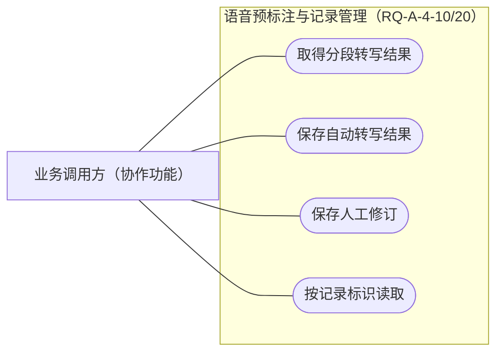
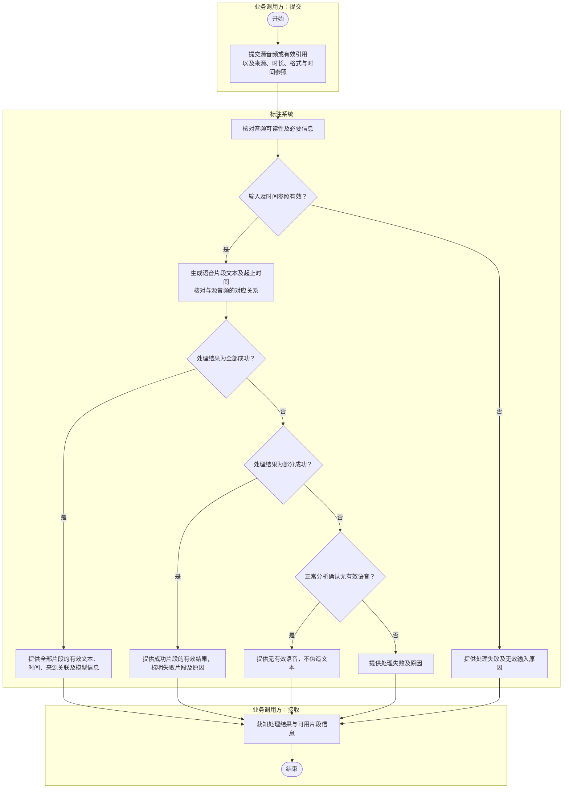
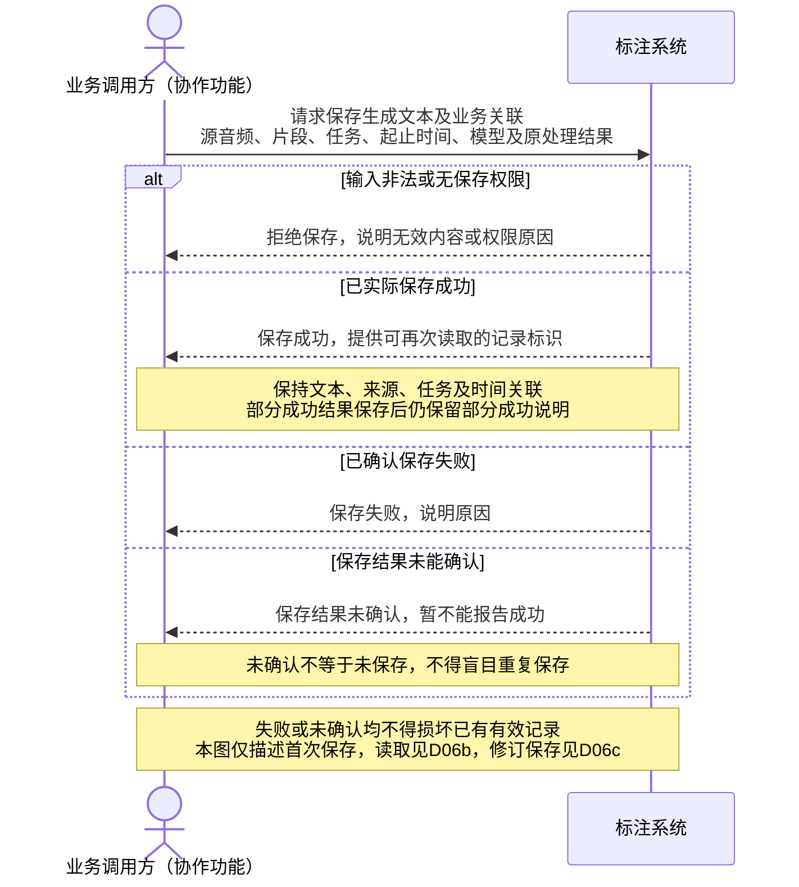
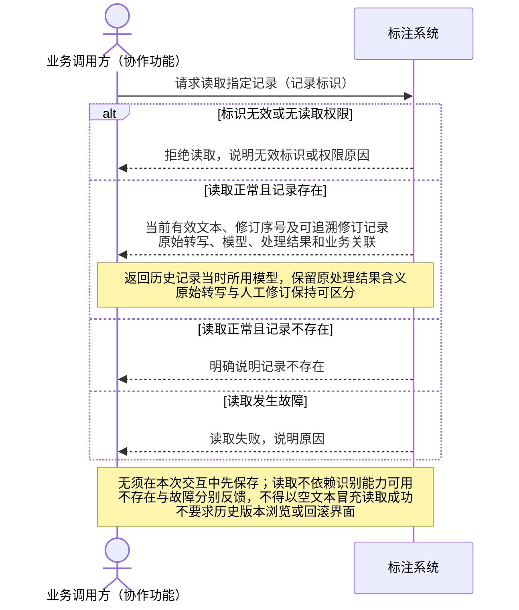
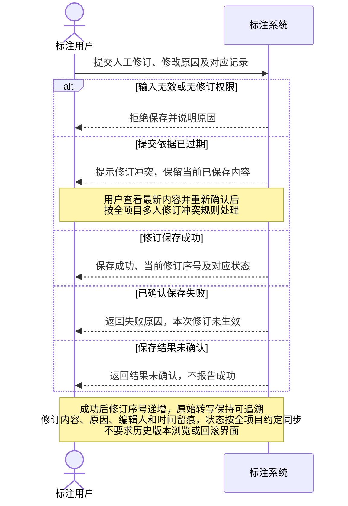
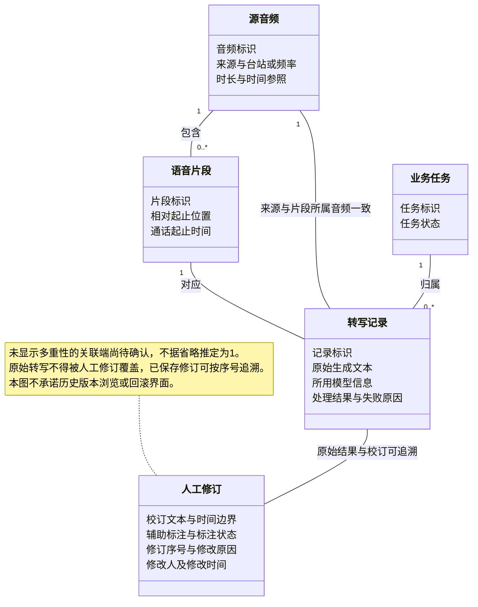
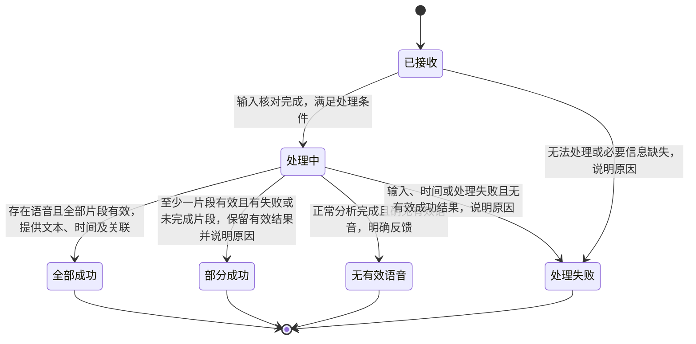

# 可视化 ATC 地空通话语音标注系统 · 需求规格说明书

语音分段转写与文本管理 · 个人版

拟制人：李洪

审核人：待评审

批准人：待批准

2026年10月20日

## 1. 引言

### 1.1 编写的目的

本说明书依据《可视化ATC地空通话语音标注系统_需求规格说明书_v1.6》全项目需求基线和现行课程项目需求列表，细化本人负责的 RQ-A-4-10（语音分段、自动转写与通话起止时间戳）和 RQ-A-4-20（生成文本及人工修订的存储与管理），作为相关需求确认、开发和测试的依据。预期读者为课程教师、项目团队及参与验证的使用者。

本文沿用课程模板第1至5章结构，规定两项需求的行为、输入输出及完成条件，并沿用全项目说明书中适用的公共约束。个人交付范围见第2.1节。

### 1.2 背景

项目由现代软件工程课程提出，P-Blue 小组开发可视化 ATC 地空通话语音标注系统，面向课程学生，处理香港国际机场（VHHH）相关地空通话数据。两项需求属于语音处理部分：把已获取的通话音频转为可复核的文本和时间信息，并将生成结果保存供后续使用。系统仅用于课程中的辅助整理与标注，不用于实际航空交通管制指挥或飞行控制。

### 1.3 定义

| 术语 | 含义 |
|----|----|
| ATC | 空中交通管制；本文指机场相关地空通话场景。 |
| VAD／语音分段 | 检测音频中有效语音的时间范围，形成待转写的语音片段。 |
| ASR／自动转写 | 把语音转换为文本；结果是供人工复核的预标注，不等同于最终人工标注。 |
| 源音频与片段 | 源音频为上游提供的可处理音频；片段是其中一个有明确起止位置的语音区间。 |
| 时间基准 | 说明时间的参照对象：绝对时间须明确时区，相对时间须明确所对应的源音频及单位。 |
| 转写记录 | 相互关联的源音频、语音片段、所属任务、起止时间、生成文本、所用模型名称或版本及处理结果。 |

“所属任务”指调用方提供标识的上层业务任务，与本次识别处理记录不同。本功能不承担上层业务任务的创建、分配或自动调度，但须提供自身识别处理的状态、结果和失败原因。

### 1.4 参考资料

（1）课程模板《03-需求规格说明书》；（2）《可视化ATC地空通话语音标注系统_需求规格说明书_v1.6.docx》（全项目需求基线）；（3）《课程项目需求列表》ATC 项目工作表；（4）《课程开发项目-思维导图》；（5）本人两项需求的《Kanban需求分析与过程方案》。

## 2. 任务概述

### 2.1 目标

为标注用户提供与源音频对应的通话文本和片段起止时间，使其能够定位、查看并复核自动识别结果；使自动生成文本及经授权协作功能提交的人工修订能够保存、再次读取和追溯，且原始转写、修订内容及其业务关联保持完整。

| 责任范围 | 本文规定的内容 |
|----|----|
| 本人负责 | 语音分段；调用规定的识别能力生成文本；形成通话起止时间；自动转写文本与协作功能提交的人工修订记录的保存、按记录标识读取及关联管理；上述操作的结果和异常反馈。 |
| 相关功能协作 | 音频获取提供音频、来源及时间信息；转写编排确定触发时机；展示或标注功能负责人工编辑并提交修订及原因；公共数据服务支持持久保存；展示、查询和导出功能使用结果。 |
| 不纳入个人交付 | 音频采集与存储管理、界面编辑、按通话时间范围检索、按策略导出、自动任务调度、共享基础数据管理、公共日志服务的完整实现，以及公共数据库建设与运维。 |

### 2.2 用户的特点

最终用户是课程学生，需要查看文本并对照音频复核，无须了解识别模型和存储实现。相关业务功能调用本文规定的能力，由展示功能呈现结果和失败原因。人工编辑由展示或标注功能承担，本文规定修订的保存、读取和追溯要求。

### 2.3 假定和约束

项目提供合规脱敏的通话音频及业务标注规范。上游提供可读取音频、来源标识及时间信息，标注功能提交修订文本及原因。识别服务和公共数据服务不可用时，按第3.5节处理。

转写采用课程规定的 sherpa-onnx 与 SenseVoice 方案。A-3 负责音频获取及采集时段切分；本人负责 VAD 通话分段、ASR 转写及文本管理，A-5 支持公共持久化。遵循项目统一标准，模型参数、接口字段和数据库结构在设计阶段确定。

## 3. 需求规定

### 3.1 对功能的规定

本范围的转写、首次保存、修订保存和读取能力如图1所示。

图 1 分段转写与文本管理需求用例图（D02）

> 图注：转写、首次保存、修订保存与读取分别响应请求。修订须保留原始转写，并记录修订序号、原因、编辑人和时间；转写成功不代表保存成功，保存成功不改变部分成功的含义。

图注：“业务调用方”指本限定范围外的现有协作功能。转写、首次保存、修订保存和读取独立响应请求，转写成功不表示已保存；按标识读取不替代按通话时间范围查询。

#### 3.1.1 语音分段、自动转写与通话起止时间戳

| 项目 | 需求规定 |
| --- | --- |
| 目标 | 把已获取的地空通话音频处理为可复核的片段文本及起止时间，供保存和展示等功能使用。 |
| 触发与前置条件 | 调用方提交待处理音频。输入须可读取、来源可识别，且提供建立通话时间所需的参照信息；识别服务可用。自动发现新音频和决定执行时机不属于本功能。 |
| 输入 | 源音频或有效音频引用，源音频标识、时长、格式及时间基准信息。本文规定数据含义，不规定请求字段名。 |
| 正常处理 | （1）核对音频可读性及必要信息，发现输入不满足要求时返回原因。 （2）对音频执行 VAD 分段，确定语音片段的起止位置。 （3）对有效语音片段进行自动转写，将文本与对应片段关联。 （4）依据源音频时间参照形成通话起止时间，检查开始早于结束且不超出源音频范围。 （5）向调用方提供文本、时间、所用模型名称或版本及处理结果，供后续保存与复核；返回转写成功不代表已经保存成功。 |
| 输出 | 源音频及片段的关联信息、成功片段的生成文本、通话起止时间、所用模型名称或版本和处理结果。仅部分片段成功时，返回成功片段的结果，并标明失败片段及原因；无有效语音与处理失败应可区分。 |
| 异常与边界 | 音频损坏、不支持的输入格式、必要信息缺失或时间基准不明时，不输出为有效成功结果。无有效语音时明确返回无语音，不生成通话文本；识别服务不可用、超时或部分片段失败时，不将整段音频标记为全部转写成功。部分失败不应丢弃已成功片段的有效结果，失败片段不得标记为转写成功。 |
| 完成条件 | 对有效样本能获得可对应到源音频的文本与起止时间；全部成功、部分成功、无语音和失败结果可区分。按第3.2.1节完成时间关联检查与质量评价并记录结果，验收判定按项目测试与验收方案执行；处理用时按第3.2.2节的性能目标评估。不能仅以程序运行成功判定识别质量达标。 |

提交音频并取得转写结果的过程如图2所示。

图 2 提交音频并取得转写结果（D04）

图注：仅在正常分析确认无有效语音时返回无语音；输入、时间关联或处理异常应反馈相应原因，不得归为无语音。有效片段须保持文本、源音频及时间对应，部分失败时保留有效结果；取得转写结果不代表保存成功。

#### 3.1.2 生成文本的存储与管理

| 项目 | 需求规定 |
| --- | --- |
| 目标 | 保存自动生成的地空通话文本及协作功能提交的人工修订和关联信息，使授权功能能够重新读取当前有效文本及修订留痕。 |
| 触发与前置条件 | 调用方提交自动转写结果或人工修订请求保存，或提交记录标识请求读取。输入须有合法业务关联，人工修订须含修改原因；调用方具备权限，公共数据服务可用。 |
| 输入 | 初始转写保存时输入生成文本、源音频及片段标识、所属任务标识、起止时间、所用模型信息和处理结果。人工修订时输入对应记录标识、修订文本、修改原因及按全项目约定所需的修订关联信息。读取时输入能够唯一定位记录的标识。 |
| 正常处理 | （1）检查待保存内容的必要信息、时间范围、来源及任务关联，拒绝无效或相互矛盾的记录。 （2）保存初始转写、模型信息、处理结果及业务关联。人工修订另行留存文本、修改原因、编辑人和时间，修订序号随每次成功保存递增，状态按全项目约定同步；原始转写和既有修订保持可追溯。 （3）仅在保存成功后返回成功结果及可用于再次读取的记录标识。 （4）按记录标识返回当前有效文本、原始转写、修订序号及留痕，以及模型、处理结果和音频、片段、任务与时间关联；记录不存在时明确反馈。 |
| 输出 | 保存结果（成功、明确失败或未确认）；成功时的记录标识，修订成功后的修订序号及对应状态；读取时的文本、修订留痕及完整业务关联。初始结果的处理状态保持不变，具体输入输出见第3.3节。 |
| 异常与边界 | 允许保存部分成功中的有效片段，保留部分成功说明。输入无效或越权时拒绝保存，提交依据过期时提示冲突，保留已有内容；保存失败或未确认时不报告成功。读取失败与记录不存在分别反馈，具体见第3.5节。按标识读取不替代时间范围查询。 |
| 完成条件 | 保存的初始转写和修订重启后仍可按标识重读，内容及关联一致；人工修订留痕完整、序号递增、状态一致，原始结果可追溯；有效部分结果可保存和读取且保留部分成功含义。无效输入、越权、冲突、明确失败及结果未确认分别处理；明确失败不改变当前有效内容和修订序号。 |

生成文本首次保存、按标识读取与人工修订保存交互分别如图3、图4和图5所示。

图 3 自动转写结果的首次保存交互（D06a）

图注：本图仅说明自动转写结果的首次保存。保存成功表示所提交的有效结果已保存，并提供可再次读取的记录标识；原处理结果为“部分成功”时，保存成功不改变该含义。保存结果未确认时不得自动重复提交。人工修订保存见D06c。

图 4 按记录标识读取转写及修订信息（D06b）

图注：读取不要求在本次交互中先保存。返回当前有效文本、修订序号及可追溯的修订记录，同时保留原始转写、历史模型信息、原处理结果与完整业务关联；不要求历史版本浏览或回滚界面。

图 5 人工修订的保存与留痕（D06c）

图注：每次成功修订后修订序号递增，原始转写保持可追溯；修改原因、编辑人和时间留痕，状态按全项目约定同步。冲突不得覆盖已有修订；不要求历史版本浏览或回滚界面。

#### 3.1.3 与相关功能的先后关系

业务主线为：音频获取提供输入 → 分段转写功能生成结果 → 文本管理功能保存初始转写 → 展示、时间查询和导出功能使用结果；人工修订由展示或标注功能提交，文本管理功能保存修订及其留痕并按标识提供读取。自动转写编排负责触发和组织调用，不因其调用分段转写而转移分段职责。公共数据服务支持持久保存。

上述顺序是业务数据依赖，不是开发排期。转写成功、保存成功和整条处理链完成必须区分。

### 3.2 对性能的规定

#### 3.2.1 精度

片段开始时间必须早于结束时间，且均在源音频范围内；文本及其所属片段、源音频的关联须正确且可追溯，不得串用其他音频的时间。时间数据至少按毫秒级保存，传输和保存不得发生无提示的精度截断。通话绝对时间采用项目统一时间基准并明确时区；片段相对位置须能依据源音频参照解释，不得混用。

生成文本在传输、保存和读取过程中不得乱码、无提示截断或改变原文。若为转写进行音频格式转换，应保留原始或可追溯音频及转换信息，供复核使用。

转写文本准确度及分段边界误差应以代表性音频、人工转写和人工时间标注为对照评价。样本覆盖静音、噪声、口音、呼号和数字等场景；有语音样本按语种采用字错误率（CER）或词错误率（WER），单独核对呼号与数字，并比较片段起止时间与人工标注的边界误差；静音样本单独检查无有效语音的反馈。

评价须记录样本范围、所用模型、评价方法与结果，验收判定按项目测试与验收方案执行。毫秒级保存精度、全项目建议的0.1秒人工编辑步进及不超过1秒的界面联动偏差目标，均不能作为实际识别或分段准确度。

#### 3.2.2 时间特性要求

ASR 处理以用时不超过音频时长的2倍为建议性能目标，即1分钟音频建议在2分钟内完成识别。测试方案须记录计时起止点、是否包含分段、排队与传输时间、模型配置及测试音频，以统一口径评估目标达成情况。

文本读取参与全项目页面或查询流程时，以“10并发用户、常规数据量下，95%普通页面／列表请求不超过2秒”为系统级建议性能目标，不将其视为单个服务的独立时限。全项目性能表中的“标注保存2秒”同属建议口径，面向人工标注提交，不是分段、识别和保存的总时限。

#### 3.2.3 灵活性

更换识别模型或调整音频接入方式时，应保持已经约定的输入输出含义兼容，不影响已有转写记录读取。公共接口新增非必需字段应尽量保持向后兼容；本功能作为调用方时，应能忽略不影响既有功能的未知字段，同时保持对必填信息及数据有效性的校验。本项目采用课程规定的识别方案，不包含模型训练或模型管理界面。

### 3.3 输入输出要求

| 操作 | 输入要求 | 输出要求 |
|----|----|----|
| 分段转写 | 音频二进制或可读取引用；来源、格式、时长及时间参照明确。不支持的输入格式应返回明确原因。 | 成功片段的文本、起止时间、所属音频、所用模型名称或版本及处理结果；部分成功时标明失败片段及原因，无语音与失败可区分。 |
| 保存文本 | 初始保存提交生成文本及其源音频、片段、起止时间、所用模型信息、处理结果和所属任务标识；人工修订提交对应记录标识、修订文本及修改原因。关联和时间须合法。 | 成功、明确失败或未确认的保存结果；成功后提供记录标识，修订成功后同时提供递增修订序号及对应状态。保存成功不改变原转写的全部或部分成功含义；冲突应明确反馈。 |
| 读取记录 | 有效的转写记录标识。 | 当前有效文本、原始转写、修订序号及留痕信息，所用模型信息、原处理结果及业务关联；不存在或读取失败时分别给出可理解反馈。 |

文字数据采用 UTF-8，结构化结果使用 JSON 等项目约定形式交换；音频按媒体数据处理，不将 UTF-8 当作音频编码。输入规范化时保留可追溯的原始来源信息。分段转写、保存和读取的结果遵循项目统一反馈约定，提供状态码、中文说明及用于问题追踪的日志编号，错误采用统一错误码；不得暴露密码、认证令牌或内部敏感配置。具体编码与字段在设计阶段统一。

### 3.4 数据管理能力要求（针对软件系统）

已确认保存成功的记录必须可持久读取，保留生成文本、起止时间、所用模型名称或版本及处理结果，并可追溯到源音频、片段和所属任务；保存和再次读取时保持上述信息与关联完整，不用当前模型信息覆盖历史记录中的模型信息。部分成功结果中的有效文本可保存，但不得改变原处理结果为部分成功的含义。按全项目的公共数据管理要求保存转写记录，保留有效音频引用，使记录与源音频的关联可读取、可追溯；具体存储组织方式在设计阶段统一确定。新一次处理或保存失败不得破坏已有有效记录。原始转写不得被人工修订覆盖；每次确认成功的修订均形成可追溯记录，保留递增修订序号、修改原因、编辑人和时间，并按全项目约定同步对应标注状态。授权功能可读取修订留痕；此要求不包括历史版本浏览或回滚界面。

原型阶段 VAD／ASR 片段的建议管理规模为10⁵～10⁶条量级，并参与全项目统一容量核算。10 GB 为数据库、音频和日志共享的全项目在线空间，由各功能共同使用；结构化数据按年增长预留至少30%余量。

全项目在线空间使用率达到80%时告警、90%时暂停非必要批量下载及新增大文件任务；本功能须反馈资源不足造成的读写失败。保留、归档和清理遵循项目规则，不擅自删除仍需保留的结果。数据库结构及具体容量管理方式在设计阶段统一确定。

### 3.5 故障处理要求

| 情况 | 可观察的处理要求 |
|----|----|
| 输入无效或时间不明 | 返回缺失或非法信息说明，不生成可被误认为有效完成的文本记录；不将时间参照不明的结果用于自动时间联动。 |
| 无有效语音 | 明确反馈无有效语音，不生成通话文本，并与服务故障区分。 |
| 识别不可用或超时 | 返回识别失败及原因，供调用方提示或后续重新发起；不得影响已有转写记录的读取。重试组织不作为本需求的新增调度功能。 |
| 仅部分片段成功 | 返回已成功片段的文本、时间及关联信息，标明失败片段及原因，不反馈整段音频全部成功。文本管理可保存通过校验的成功片段，并保留原处理结果为部分成功的说明；保存成功不改变该含义。 |
| 存储不可用或保存未确认 | 不提示保存成功，不损坏原有有效记录；明确区分已确认失败与结果未能确认，不盲目覆盖或生成重复记录。 |
| 记录不存在或读取失败 | 向调用方区分记录不存在与服务故障，不得将这两种情况表示为读取成功。 |
| 非法或无权限操作 | 拒绝执行并提供可理解原因，不修改受保护数据；遵循全项目统一访问权限规则。 |

多人同时修改同一标注时，若提交依据已被更新，应提示修订冲突并保留当前已保存内容；用户查看最新内容并重新确认后方可再次提交，不得直接覆盖他人已保存的修订。

与上述操作相关的错误须提供时间、来源、错误级别及可定位的请求或任务信息，供公共日志功能记录与排查；结果反馈中的日志编号与公共日志功能保持关联。

### 3.6 其他专门要求

自动转写结果应明确属于预标注，供人工复核，不直接等同最终标注。音频和文本仅用于项目约定的处理与标注用途；读取与保存遵循系统权限规则。处理失败的提示不得泄露个人信息或服务凭据。

功能说明应能让调用方理解输入、结果及失败含义。设计或实现发生变化时，仍须满足本文规定的数据关联、原始结果可追溯及成功反馈真实性要求。

## 4. 数据规定

### 4.1 数据的逻辑描述

本章规定业务数据的含义和对应关系。

#### 4.1.1 静态数据

与处理有关的台站／频率等来源描述、已约定的音频与时间解释规则，以及所采用识别模型的名称和版本信息。共享基础信息由项目相关功能提供。

#### 4.1.2 动态输入数据

待处理的源音频或引用，音频标识、时长和时间参照；待保存的片段、生成文本、起止时间、所用模型名称或版本、处理结果及调用方提供的所属任务标识；人工修订文本、修改原因及对应记录标识；读取请求中的记录标识。

#### 4.1.3 动态输出数据

成功片段的通话时间范围、对应文本及所用模型名称或版本，部分成功时的失败片段及原因；保存结果与记录标识，读取的当前有效文本、原始转写、修订序号、修订留痕、时间、模型信息、处理结果及所属音频、片段和任务关联；无语音、输入无效、冲突、失败或结果未确认等反馈。反馈格式遵循第3.3节的统一约定。

#### 4.1.4 内部生成数据

VAD 形成的语音片段及相对位置，ASR 生成文本，按源音频参照形成的通话起止时间，以及处理来源、所用模型名称或版本、必要的耗时和失败原因。这些数据用于结果复核与故障定位。

#### 4.1.5 数据约定

一份源音频可以包含多个语音片段；每个转写结果必须明确所属片段和源音频，不能仅依靠文件名确定唯一关联。源音频、片段和转写记录均须可唯一识别。保存结果时保留调用方提供的上层业务任务标识，读取时返回该关联；该业务任务的创建、分配和自动调度不属于本功能，识别处理自身的状态与结果仍须可追踪。

通话绝对时间须使用项目统一时间基准，禁止仅保存无时区的模糊时间。片段相对时间须明确单位和源音频参照，依照“源音频绝对起始时间＋片段相对位置”解释通话时间，二者不得混用。具体表示形式在设计阶段统一，分段及转写不得改变原始音频时间参照。文本统一采用 UTF-8。

自动生成原文与人工修订内容保持可区分、可追溯。确认成功的修订按全项目约定保留递增序号、修改原因、编辑人和时间，并同步对应标注状态；读取时可提供修订留痕供授权功能追溯。此要求不包括历史版本浏览或回滚界面。

相关业务概念及其对应关系如图6所示。

图 6 语音预标注与校订领域概念图（D08）

图注：本图为局部领域概念图。未标出的多重性尚待确认，不据省略推定为1；转写来源须与片段所属音频一致。原始结果不得被人工修订覆盖；修订序号及留痕信息可追溯，不要求历史浏览或回滚界面。人工修订由相关协作功能提供。

### 4.2 数据的采集

#### 4.2.1 要求和范围

本功能接收已经获取的地空通话音频及元数据，不直接承担 LiveATC 下载、实时音频采集或航迹采集。音频应能追溯来源，且具备解释通话起止时间所需的信息；缺失信息按输入异常处理。

#### 4.2.2 输入的承担者

A-3 音频获取功能负责提供音频、音频标识、时长及采集时间等信息；自动转写编排等调用方负责提交处理请求；展示或标注功能负责提交人工修订及修改原因；文本管理功能保存初始转写和人工修订记录并按约定提供读取；查询和导出等功能按约定使用结果。A-5 公共数据服务承担共享持久化支持。

#### 4.2.3 预期处理

接收与核对输入 → VAD 语音分段 → ASR 自动转写 → 形成片段时间和文本关联 → 校验并保存生成结果 → 提供后续读取。必要的格式适配不得使原始音频失去可追溯性。每个操作分别反馈结果，不把转写结果已返回误认为已经完成持久保存。

#### 4.2.4 影响

音频不可读或时间信息不完整会影响分段、转写和通话定位，应向上游说明所缺条件。转写结果的时间或来源关联错误会影响展示、时间查询和导出，保存前必须校验。识别服务故障不应阻止已有文本读取；公共存储故障则会影响保存及读取，两类问题须分别反馈。

## 5. 运行环境规定

### 5.1 设备

| 对象 | 继承的环境约束及适用范围 |
|----|----|
| 公共业务后端 | 1 vCPU、512 MB 内存，用于业务接口及轻量处理，不作为大模型推理资源。 |
| 在线存储 | 全项目共享10 GB，包含数据库、音频和日志；个人文本管理参与统一核算。 |
| 语音识别服务 | 独立部署 sherpa-onnx 与 SenseVoice，处理器和内存按所选模型实际需求配置。 |

### 5.2 支持软件

业务后端使用 Python／FastAPI，目标服务器环境为 Linux／Debian x64；语音识别采用课程规定的 sherpa-onnx 与 SenseVoice ATC 模型及相关服务。数据库产品、版本和结构在设计阶段由团队确定。

用户通过浏览器访问系统，Chrome 为主要开发和验收浏览器。JavaScript 为前端开发语言，Node.js 为相关开发运行环境；生成结果须能被调用方正确使用。

### 5.3 接口

本节只规定交换对象与业务内容。沿用全项目以 HTTP／HTTPS 交换信息、以 JSON 交换主要结构化数据的公共约束；具体地址、字段、错误码和认证形式在设计阶段统一。

| 交换对象 | 需要交换的业务内容 |
|----|----|
| 音频获取及调用方 | 接收音频或有效引用、来源及时间信息；返回文本、片段时间、所用模型名称或版本及处理结果。 |
| 独立识别服务 | 提交有效语音内容，接收自动识别文本或失败原因；VAD 分段及通话时间需求仍由分段转写功能负责满足。 |
| 公共数据服务 | 提交包含所用模型名称或版本、处理结果及关联信息的初始转写记录，或提交人工修订及修改原因，获取保存结果；按记录标识获得当前有效文本、原始转写、修订序号和修订留痕、模型信息、处理结果及关联信息，或明确失败反馈。 |
| 展示、查询及导出功能 | 提供可识别、可追溯的文本与片段信息；不接管其他功能的查询条件处理、界面交互或导出策略。 |

### 5.4 控制

转写、保存和读取由相关调用方请求触发。处理过程中及完成后，调用链应提供处理状态、结果和失败原因；本功能提供相应信息，展示与任务组织由协作功能完成，不在本文固定内部状态枚举。

后台语音处理不得阻塞已有数据的浏览与校订。自动触发、调度和重试组织由相关编排功能承担；本功能提供处理状态并正确响应有效调用。人工修订保存成功后，修订序号、编辑留痕和对应标注状态须按全项目约定保持一致。只有保存得到确认后，才把本次修订作为已保存结果对外提供；结果未确认时不得报告成功或自动重复提交。

一次预标注处理的对外概念状态及结果如图7所示。

图 7 一次预标注处理的对外状态（D09）

图注：前提：本次处理请求已接收。状态名称仅解释一次处理的对外含义，不固定状态枚举或进度展示方式。存在有效成功片段且另有失败或未完成片段时属于部分成功；无有效语音须经正常分析确认。任何处理结果均不等同保存确认，也不代替识别质量验收。
