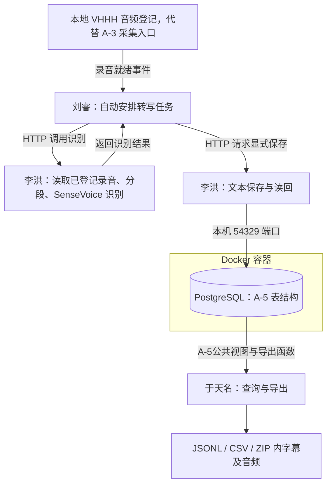

# Docker 与联调入门操作

> 2026-11-07执行口径更新：本轮严格按团队主仓库交付开展。当前数据库部署前提不完整，停在前置检查，不运行本文历史实验的P-Blue初始化和业务重放命令。下文环境及链路说明用于理解既有记录，不代表主仓库独立部署已通过。最新进度见[主仓库数据库独立部署复核](../deliverables/测试/2026-11-07-团队主仓库数据库独立部署复核.md)；于天名最新SRT两项定向测试已通过。

核对日期：2026-10-31。适用本机现有环境。

## 1. 这次 Docker 具体做什么

本次 Docker 负责运行 PostgreSQL 数据库。李洪的语音服务、教师 SenseVoice 模型、刘睿的自动调度代码、于天名的查询导出代码在本机 Python 环境执行。

此前“同批数据已联调”的准确范围是：把同学已提交的代码快照在本机运行，验证各部分能处理同一批真实音频和数据库记录；尚未连接同学各自电脑上的服务。



音频文件与模型文件保留在 Windows 文件夹中。数据库记录音频位置、时间、分段、识别任务、识别文本等信息；音频本身没有作为大文件存入数据库。

2026-10-31原55433被Windows保留，当前改用54329。数据卷保持原样；旧容器`a4-lihong-postgres-20261030`停止保留，请使用新容器名。

## 2. 四个 Docker 概念

| 概念 | 含义 | 你的实例 |
|---|---|---|
| 镜像 Image | 创建运行环境的模板，包含程序及依赖 | 下载的 PostgreSQL 官方镜像 |
| 容器 Container | 从镜像创建出来、可以启动和停止的程序实例 | `a4-lihong-postgres-20261031` |
| 数据卷 Volume | 为容器保存持久数据的位置，生命周期独立于运行中的进程 | `a4-lihong-pg16-20261030` |
| 端口映射 Port | 将电脑上的连接入口转发到容器内程序 | 电脑 `127.0.0.1:54329` → 容器 `5432` |

这里的 `127.0.0.1` 表示这台电脑自身。Python 服务向电脑54329端口连接，Docker 转发到容器内 PostgreSQL 的5432端口。54329是数据库入口；8001是手动启动语音 HTTP 服务的入口；新版重放临时使用18051（识别）、18052（自动化）、18053（查询导出）。

## 3. Docker Desktop 常见入口

| 入口 | 用途 | 本项目当前用法 |
|---|---|---|
| Containers | 查看容器、启动、停止、重启、查看日志 | 找到 `a4-lihong-postgres-20261031`；Running/Up表示运行中 |
| Images | 查看已下载的镜像 | 找 PostgreSQL 镜像；已有容器日常直接启动即可 |
| Volumes | 查看持久数据卷及关联容器 | 保存数据库实际数据；保留本项目的数据卷 |
| Builds | 查看从 Dockerfile 构建镜像的记录 | 本轮使用现成 PostgreSQL 镜像，无须操作 |
| Kubernetes | 管理多服务集群环境 | 本机课程联调暂不使用 |
| Settings | 配置 Docker 的资源、网络、代理等 | Docker 已可运行，平时无须调整 |

界面可能还显示 Models/AI、Docker Hub、Extensions 等入口：分别用于容器相关模型服务、镜像分发、插件扩展。本项目教师 SenseVoice 由 Python/sherpa-onnx 加载，当前无需操作这些入口。此前 `dockerInference` 报错属于 Docker 自身的推理管理组件启动故障，与本项目模型的识别结果无关。

Docker Desktop 的 Logs 页面查看的是容器日志。当前容器内只有数据库，因此能看到数据库启动与连接错误；Python 模型和语音服务的日志另存于联调结果文件夹的 `speech.log`。

## 4. 最容易操作的完整联调重放

2026-10-31已按于天名新版重跑；新版直接接A-5公共视图及正式导出任务表，使用以下命令。详见[新版联调报告](../deliverables/测试/2026-10-31-A4新版查询导出与A3-A5更新联调核对.md)。

先打开Docker Desktop，等引擎启动，在普通PowerShell执行：

```powershell
Set-Location -LiteralPath 'D:\course_project\现代软件工程\SEPA2026_TeamBlue\李洪'
docker start a4-lihong-postgres-20261031
$taskProbe = .\.venv\Scripts\python.exe tools/automation_http_integration_2024141460331.py --audit-dir .doc-sync-work/main-audit-20261031 | ConvertFrom-Json
.\.venv\Scripts\python.exe tools/query_export_integration_2024141460331.py --automation-summary $taskProbe.summaryFile
```

第一条Python命令启动刘睿独立HTTP服务及本人识别保存HTTP服务，使用真实20秒音频、实际模型、正式数据库表，验证9项。第二条启动于天名新版HTTP服务，处理同一批文本，验证14项查询、导出、下载及重启检查。

通知来自本地测试客户端。新版音频导出会向A-3下载录音，当前由本地HTTP测试入口提供真实WAV以核验协议，真实A-3采集与下载服务尚未接通。所有临时服务结束后关闭，数据库继续运行；原始录音UTC未知，登记时明确标记测试时间。

结果分别在`outputs/postgres/automation-http-<编号>/`和`outputs/postgres/query-export-<编号>/`：`summary.json`看各项状态及标识；`speech.log`、`automation.log`、`query.log`看对应服务；新版`exports/`含JSONL、CSV和ZIP。运行会新增本地测试数据。

原`postgres_integration_2024141460331.py`保留昨日旧版重放能力，不能用来证明新版接口通过。

只看到容器 Running 只能证明数据库进程在运行；出现 `status: passed` 才表示上述联调检查通过。

## 5. 手动启动服务并在浏览器读回已有文本

这一部分方便理解接口；完整重放使用上一节即可。

在本人目录的 PowerShell 中运行：

```powershell
docker start a4-lihong-postgres-20261031
$taskPg = Get-Content -LiteralPath 'outputs/postgres/runtime.local.json' -Raw | ConvertFrom-Json
$env:A4_DATABASE_URL = $taskPg.appDsn
$env:A4_SERVICE_API_KEY = 'local-a4-learning-only'
.\.venv\Scripts\python.exe -m a4_speech.api_2024141460331 --config config.postgres.local.json --host 127.0.0.1 --port 8001
```

这里 `local-a4-learning-only` 是仅用于本机学习的示例服务密钥，方便在接口页面手动输入；共用环境应使用双方约定的独立凭据。数据库口令已经保存在本地配置，不需要手动抄写。

命令会持续运行并占用当前 PowerShell 窗口。保持窗口打开，在浏览器访问 `http://127.0.0.1:8001/docs`：

1. 点击 **Authorize**，在 ServiceApiKey 输入 `local-a4-learning-only`。
2. 找 `GET /api/v1/a4/transcripts/{transcriptId}`，点击 **Try it out**。
3. 在 transcriptId 填 `a3a2c4ca-a622-4b46-9a46-4fae5cc04006`，jobId 留空，点击 **Execute**。
4. 查看200响应中的 `textRaw`、`startMs`、`endMs`、`jobId`、`revision`。这条记录来自此前保存的真实数据库行。

`GET /health`可检查语音HTTP服务是否启动。11/07起，人工修订`PATCH`已支持PostgreSQL模式；须配置`a5Url`并启动可信IAM服务，同时提供服务密钥和真实用户Bearer。IAM未配置或不可达时仍返回`REVISION_AUTH_UNAVAILABLE`。详见[接入说明](PostgreSQL本地接入与组内联调.md)。

要新做识别，录音必须先登记。上一节完整脚本会自动完成登记、产生新的录音 ID 并验证结果；不要把已经有文本的录音直接重复当作新任务提交。

## 6. 日常 Docker 命令

```powershell
docker ps
docker ps -a
docker logs --tail 30 a4-lihong-postgres-20261031
docker stop a4-lihong-postgres-20261031
docker start a4-lihong-postgres-20261031
```

依次表示：查看运行中的容器；查看全部容器；查看数据库最近日志；停止数据库；重新启动数据库。结束本方 Python 语音服务时，在运行它的 PowerShell 窗口按 Ctrl+C。停止容器保留数据卷和已保存文本。

## 7. 课程模块怎样分工

| 模块 | 主要职责 | 与这轮联调的关系 |
|---|---|---|
| A-1 界面 | 地图、航迹、音频播放器、文本及时间轴等用户界面 | 本轮未接前端界面 |
| A-2 航迹获取 | 获取航班与航迹点，生成对应时间信息 | 本轮未接航迹 |
| A-3 语音获取 | 采集/下载录音，登记捕获时间、文件和存取信息 | 本轮用本地文件导入代替实际采集入口 |
| A-4 语音处理 | 识别、文本管理、查询、导出、自动执行 | 本轮主要验证对象 |
| A-5 数据库接口与VSP数据 | 数据库结构、接口、用户权限及航空参考数据等 | 本轮复用其原始数据库结构 |

A-4内部：李洪10/20负责分段识别、文本保存和读回；于天名30/40负责按时间查询、按策略导出；刘睿50/99负责自动编排及相关任务/日志。数据库适配器把本方 Python 调用映射到 A-5 `aud/asr` 表；本地只读兼容视图让于天名的现有字段名对应同一批表记录。

如果以后在不同同学的电脑上联调，还要确定服务地址、凭据、数据 ID 和真实 UTC 等共同约定。各自在 Docker 建一个数据库得到的是各自独立的数据，不能因此自动共享。本机数据库目前只绑定 `127.0.0.1`，外部电脑无法直接连接。

## 8. 参考

- [Docker 官方：容器是什么](https://docs.docker.com/get-started/docker-concepts/the-basics/what-is-a-container/)
- [Docker 官方：端口发布](https://docs.docker.com/get-started/docker-concepts/running-containers/publishing-ports/)
- [Docker 官方：Desktop 各功能入口](https://docs.docker.com/desktop/use-desktop/)
- [项目：PostgreSQL 接入与配置](PostgreSQL本地接入与组内联调.md)
- [项目：真实数据库联调记录](../deliverables/测试/2026-10-30-PostgreSQL真实持久化与A4联调.md)
